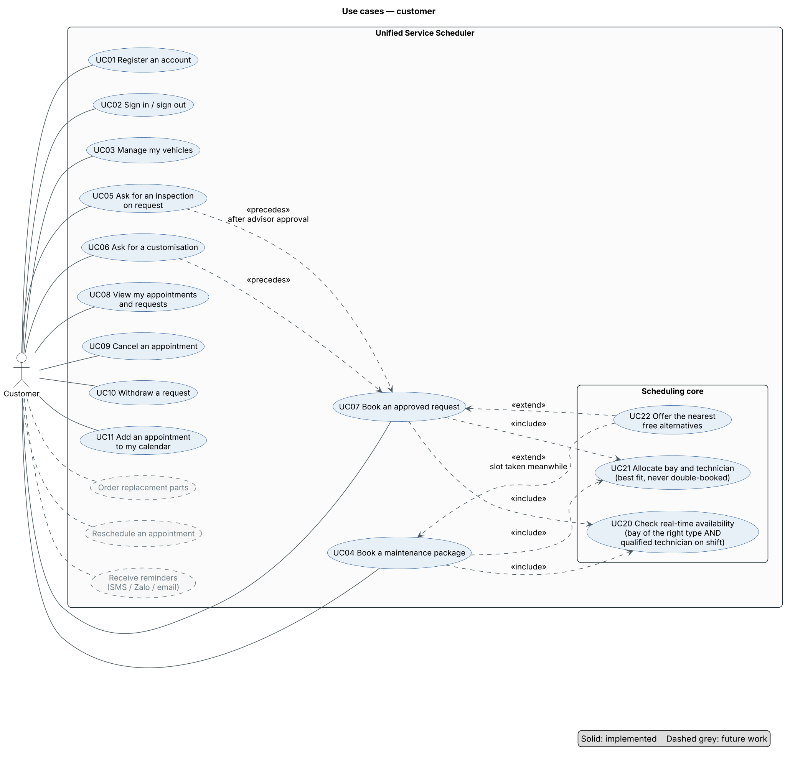
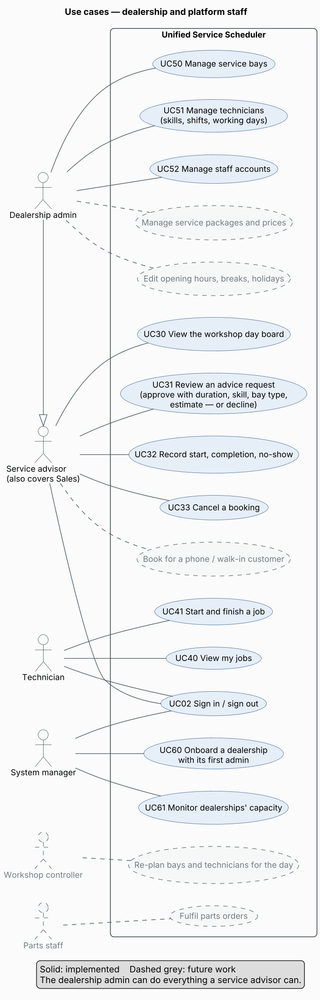
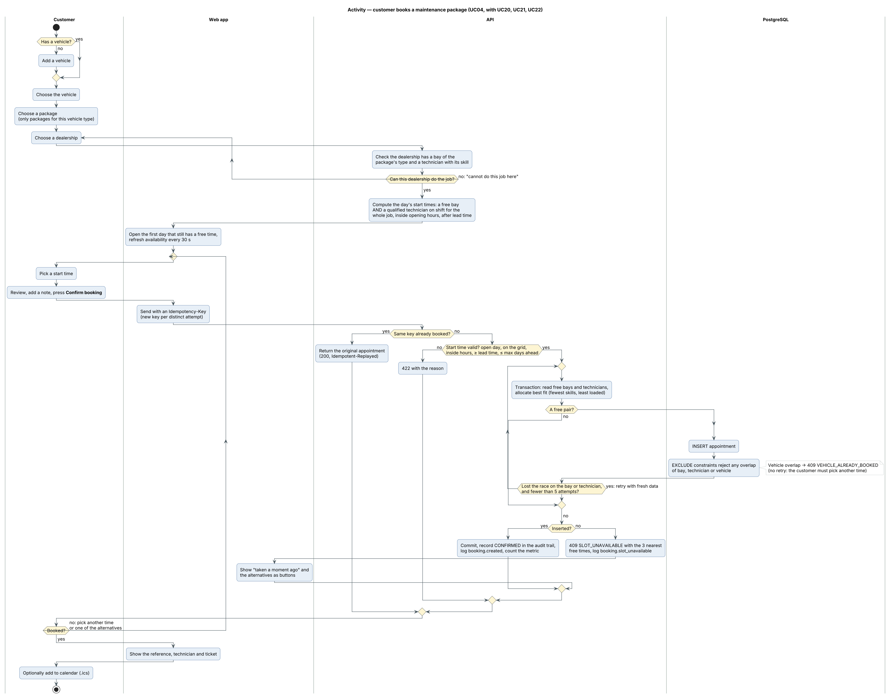
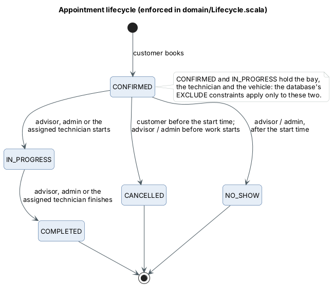
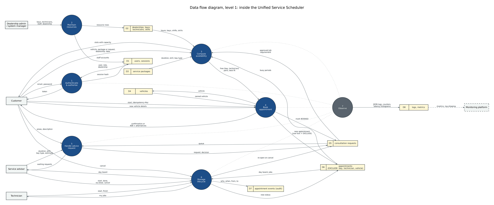
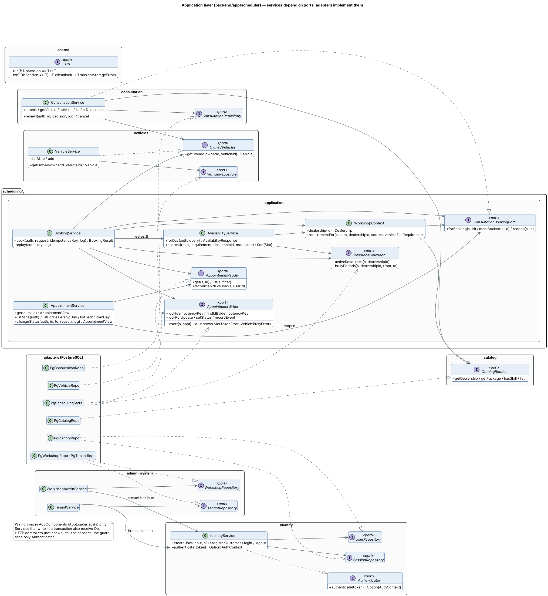
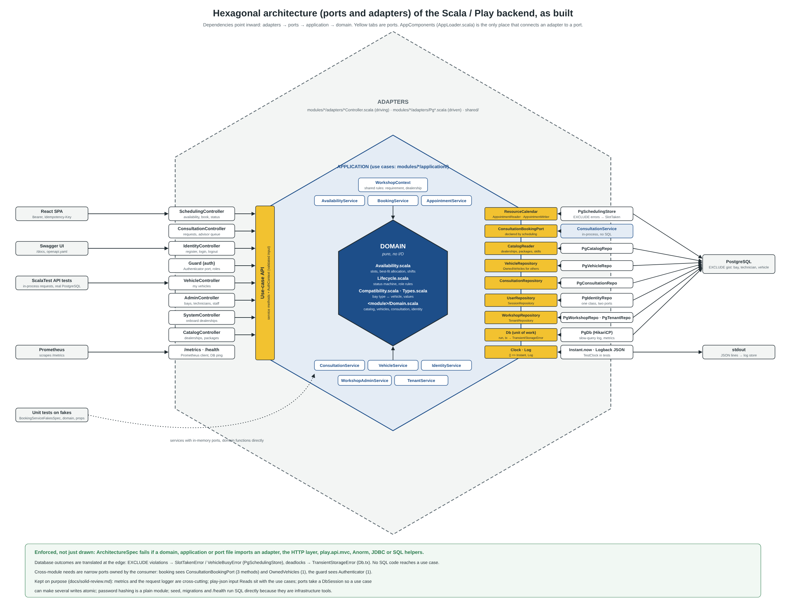

# Diagrams

Sources are PlantUML (`*.puml`, shared style in `_style.iuml`); `*.png` and `*.svg` are
rendered from them. To re-render: `java -DPLANTUML_LIMIT_SIZE=16384 -jar plantuml.jar -tpng -tsvg docs/diagrams/*.puml`
(Graphviz needed). Data flow diagrams are Graphviz (`dot -Tpng -Gdpi=150 dfd-*.dot`); the hexagonal
diagram is generated by `src/hexagonal.py` as SVG and screenshotted to PNG.

Solid shapes are implemented. Dashed grey shapes are future work that came up while scoping and
was deliberately left out of this version.

| Diagram | File |
| --- | --- |
| Use cases, customer | [use-case-customer.png](use-case-customer.png) |
| Use cases, dealership and platform staff | [use-case-staff.png](use-case-staff.png) |
| Activity, book a maintenance package | [activity-book-package.png](activity-book-package.png) |
| Activity, inspection on request / customisation | [activity-consult-first.png](activity-consult-first.png) |
| Activity, the workshop day | [activity-workshop-day.png](activity-workshop-day.png) |
| State, appointment lifecycle | [state-appointment.png](state-appointment.png) |
| Data flow, level 0 (context) | [dfd-context.png](dfd-context.png) |
| Data flow, level 1 (processes and stores) | [dfd-level1.png](dfd-level1.png) |
| Class, domain model (persisted entities) | [class-domain-model.png](class-domain-model.png) |
| Class, application layer (scheduling and collaborators) | [class-application.png](class-application.png) |
| Hexagonal architecture, as built | [hexagonal-architecture.png](hexagonal-architecture.png) |

### Reading the structural diagrams

- **Data flow, level 1**: every data store D1–D8 maps to tables in `backend/conf/db/migration/V1__init.sql` (D8 is
  logs and metrics, not a table). External entities never write a store directly; all writes go
  through a numbered process.
- **Class, application**: every application service, the ports it depends on, and the PostgreSQL
  adapter that implements each port (after the SOLID refactor, see `docs/solid-review.md`).
- **Hexagonal architecture**: drawn as built. Every driven dependency goes through a port, and
  `ArchitectureSpec` fails the build if inner code imports an adapter.

## Traceability: diagrams → code → tests

Status: **Done** = implemented and covered by an automated test; **Done (UI)** = implemented,
verified in the browser, no automated UI test; **Partial** = only part of the use case exists;
**Future** = drawn dashed, not built.

### Customer

| Use case | API | Screen | Test (backend/test/scheduler/…) | Status |
| --- | --- | --- | --- | --- |
| UC01 Register an account | `POST /api/auth/register` | Create account | `ApiSpec` › authentication | Done |
| UC02 Sign in / sign out | `POST /api/auth/login`, `/logout` | Sign in, top bar | `ApiSpec` › logout really revokes the token | Done |
| UC03 Manage my vehicles | `GET/POST /api/me/vehicles` | My vehicles, inline in booking | `ApiSpec` (vehicles used throughout) | **Partial**: add and list only; no edit (e.g. mileage) or remove |
| UC04 Book a maintenance package | `GET /api/availability`, `POST /api/appointments` | Book a service | `ApiSpec` › booking a maintenance package | Done |
| UC05 Ask for an inspection | `POST /api/consultations` | Check something specific | `ApiSpec` › inspection on request | Done |
| UC06 Ask for a customisation | `POST /api/consultations` (kind MODIFICATION) | Customise my vehicle | `ApiSpec` › customisation request | Done |
| UC07 Book an approved request | `POST /api/appointments` with `consultationRequestId` | Pick a time | `ApiSpec` › the customer books it | Done |
| UC08 View appointments and requests | `GET /api/me/appointments`, `/api/me/consultations` | Home, My appointments, Advice requests | `ApiSpec` › shows it everywhere it should | Done |
| UC09 Cancel an appointment | `POST /api/appointments/:id/cancel` | My appointments | `ApiSpec` › cancel before the start frees the slot; too late after | Done |
| UC10 Withdraw a request | `POST /api/consultations/:id/cancel` | Advice requests | `ApiSpec` › UC10 | Done |
| UC11 Add to my calendar | none (client-side .ics) | Confirmation, My appointments | none | Done (UI) |
| UC20 Real-time availability | `GET /api/availability` | Slot grid, refresh 30 s | `AvailabilitySpec`, `AvailabilityPropertySpec` | Done |
| UC21 Allocate bay and technician | inside `POST /api/appointments` | none | `BookingConcurrencySpec`, property tests, best-fit tests | Done |
| UC22 Nearest alternatives | 409 `details.alternatives` | "Taken a moment ago" buttons | `ApiSpec` › nearest free alternatives | Done |
| Order replacement parts | none | none | none | Future |
| Reschedule | none (cancel and rebook) | none | none | Future |
| Reminders (SMS / Zalo / email) | none | none | none | Future |

### Staff

| Use case | API | Screen | Test | Status |
| --- | --- | --- | --- | --- |
| UC30 Workshop day board | `GET /api/staff/appointments`, `/api/staff/resources` | Workshop day | `ApiSpec` › shows it everywhere it should | Done |
| UC31 Review an advice request | `GET /api/staff/consultations`, `POST /api/consultations/:id/review` | Advice requests (staff) | `ApiSpec` › advisor turns it into a schedulable job | Done |
| UC32 Record start, completion, no-show | `POST /api/appointments/:id/status` | Board side panel | `ApiSpec` › technician workflow, no-show only after start | Done |
| UC33 Cancel a booking | `POST /api/appointments/:id/cancel` | Board side panel | `ApiSpec` › UC33 | Done |
| UC40 View my jobs | `GET /api/technician/jobs` | My jobs | `ApiSpec` › the technician sees the job | Done |
| UC41 Start and finish a job | `POST /api/appointments/:id/status` | My jobs | `ApiSpec` › works through it; UC41 other technician's job → 403 | Done |
| UC50 Manage service bays | `GET/POST /api/admin/bays`, `PATCH …/:id` | Bays & team › Service bays | `ApiSpec` › admin adds a bay; cannot touch another dealership | Done |
| UC51 Manage technicians | `GET/POST /api/admin/technicians`, `PATCH …/:id` | Bays & team › Technicians | `ApiSpec` › admin adds a technician | **Partial**: add (skills, shift, days, login) and deactivate; no edit of an existing technician's skills or shift |
| UC52 Manage staff accounts | `GET/POST /api/admin/staff` | Bays & team › Staff accounts | none | **Partial**: create and list; no deactivate or password reset |
| UC60 Onboard a dealership | `POST /api/system/dealerships` | Dealerships | `ApiSpec` › system manager onboards a dealership | Done |
| UC61 Monitor dealerships | `GET /api/system/dealerships` | Dealerships | `ApiSpec` › UC61 | Done |
| Admin generalises advisor | role guard allows `ADMIN` on every advisor route | same screens | role tests | Done |
| Book for a phone / walk-in customer | none | none | none | Future |
| Manage packages and prices | none (seeded catalogue) | none | none | Future |
| Opening hours, breaks, holidays | set at onboarding only | none | none | Future |
| Workshop controller, parts staff | none | none | none | Future |

### Activity steps checked against the code

| Diagram step | Where it is enforced |
| --- | --- |
| Only packages for this vehicle type | `BookPage` filters by type; API returns 422 `PACKAGE_NOT_FOR_VEHICLE` |
| "Can this dealership do the job?" | `isOfferedHere` → `offeredHere: false`; UI shows the explanation |
| Free bay AND qualified technician on shift for the whole job | `domain/Availability.scala` `allocate`, `isOnShift`, `daySlots` |
| Open the first day with a free time; refresh every 30 s | `BookPage` `autoPick`; `refetchInterval: 30_000` |
| New Idempotency-Key per distinct attempt | `BookPage` regenerates the key when slot, vehicle, package or dealership change |
| Start-time rules (open day, grid, hours, lead time, max days) | `validateStart` → 422 with a code |
| Best fit, retry on a lost race (≤ 5), then 409 with 3 alternatives | `BookingService.book`, `MaxAttempts = 5`, `AvailabilityService.nearest` |
| EXCLUDE constraints on bay, technician, vehicle | `backend/conf/db/migration/V1__init.sql`; each tested on its own |
| Advisor's bay type must fit the vehicle | `ConsultationService.review` → 422 `BAY_TYPE_NOT_FOR_VEHICLE` |
| Request and appointment change in one transaction | `markBooked` inside the booking transaction |
| Cancelling a consulted appointment re-opens the request | `changeStatus` → `consultations.reopen` |
| No-show only after the start; cancel only before work starts | `domain/Lifecycle.scala` `checkTransition` |
| A technician only moves their own jobs | `changeStatus` compares `technicianIdForUser` |
| Audit row, log line and metric for every status change | `recordEvent`, `appointment.status_changed`, `appointment_status_changes_total` |

### Gaps found while tracing

1. **Tests missing for four drawn use cases** (UC10, UC33, UC41's "other technician", UC61).
   Added; the backend suite is now 95 tests (plus the 1000-request load test).
2. **UC03, UC51, UC52 are partial** (see tables). Either build the missing edits or redraw these
   use cases with a narrower name before submission.
3. Nothing in the code contradicts a drawn flow.
