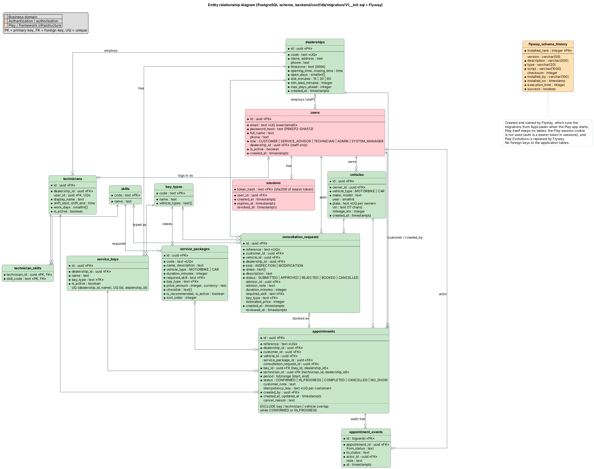

# Diagrams

Sources are PlantUML (`*.puml`, shared style in `_style.iuml`); `*.png` and `*.svg` are
rendered from them. To re-render: `java -DPLANTUML_LIMIT_SIZE=16384 -jar plantuml.jar -tpng -tsvg docs/diagrams/*.puml`
(Graphviz needed). Data flow diagrams are Graphviz (`dot -Tpng -Gdpi=150 dfd-*.dot`); the hexagonal
diagram is generated by `src/hexagonal.py` as SVG and screenshotted to PNG.

Blue (solid) shapes are in this version: the customer books, the technician carries out the
job, the system manager sees everything. **Solid grey** shapes were built before the scope-down to
those three roles and are not in this version of the web app; the backend and its tests still
have them, so they can come back without new code. **Dashed grey** shapes are future work that
was never built. The class, ERD and hexagonal diagrams draw the backend as built, so they have no
grey.

| Diagram | File |
| --- | --- |
| Use cases, customer | [use-case-customer.png](use-case-customer.png) |
| Use cases, dealership and platform staff | [use-case-staff.png](use-case-staff.png) |
| Activity, book a maintenance package | [activity-book-package.png](activity-book-package.png) |
| Activity, inspection on request / customisation | [activity-consult-first.png](activity-consult-first.png) |
| Activity, the workshop day | [activity-workshop-day.png](activity-workshop-day.png) |
| State, appointment lifecycle | [state-appointment.png](state-appointment.png) |
| Data flow, level 0 (context) | [dfd-context.png](dfd-context.png) |
| Data flow, level 1 (processes and stores) | [dfd-level1.png](dfd-level1.png) |
| Class, domain model (persisted entities) | [class-domain-model.png](class-domain-model.png) |
| Class, application layer (scheduling and collaborators) | [class-application.png](class-application.png) |
| Hexagonal architecture, as built | [hexagonal-architecture.png](hexagonal-architecture.png) |
| Entity relationship (all tables; green domain, red auth, orange framework) | [erd.png](erd.png) |

### Reading the structural diagrams

- **Data flow, level 1**: every data store D1–D8 maps to tables in `backend/conf/db/migration/V1__init.sql` (D8 is
  logs and metrics, not a table). External entities never write a store directly; all writes go
  through a numbered process.
- **Class, application**: every application service, the ports it depends on, and the PostgreSQL
  adapter that implements each port (after the SOLID refactor, see `docs/solid-review.md`).
- **Hexagonal architecture**: drawn as built. Every driven dependency goes through a port, and
  `ArchitectureSpec` fails the build if inner code imports an adapter.

## Traceability: diagrams → code → tests

Status: **Done** = implemented and covered by an automated test; **Done (UI)** = implemented,
verified in the browser, no automated UI test; **Partial** = only part of the use case exists;
**Future** = drawn dashed, not built; **Not in this version** = built and tested in the backend, drawn solid grey, no page in the web app.

### Customer

| Use case | API | Screen | Test (backend/test/scheduler/…) | Status |
| --- | --- | --- | --- | --- |
| UC01 Register an account | `POST /api/auth/register` | Create account | `ApiSpec` › authentication | Done |
| UC02 Sign in / sign out | `POST /api/auth/login`, `/logout` | Sign in, top bar | `ApiSpec` › logout really revokes the token | Done |
| UC03 Manage my vehicles | `GET/POST /api/me/vehicles` | My vehicles, inline in booking | `ApiSpec` (vehicles used throughout) | **Partial**: add and list only; no edit (e.g. mileage) or remove |
| UC04 Book a maintenance package | `GET /api/availability`, `POST /api/appointments` | Book a service | `ApiSpec` › booking a maintenance package | Done |
| UC05 Ask for an inspection | `POST /api/consultations` | Check something specific | `ApiSpec` › inspection on request | Not in this version (backend done) |
| UC06 Ask for a customisation | `POST /api/consultations` (kind MODIFICATION) | Customise my vehicle | `ApiSpec` › customisation request | Not in this version (backend done) |
| UC07 Book an approved request | `POST /api/appointments` with `consultationRequestId` | Pick a time | `ApiSpec` › the customer books it | Not in this version (backend done) |
| UC08 View my appointments | `GET /api/me/appointments` | Home, My appointments | `ApiSpec` › shows it everywhere it should | Done |
| UC09 Cancel an appointment | `POST /api/appointments/:id/cancel` | My appointments | `ApiSpec` › cancel before the start frees the slot; too late after | Done |
| UC10 Withdraw a request | `POST /api/consultations/:id/cancel` | Advice requests | `ApiSpec` › UC10 | Not in this version (backend done) |
| UC11 Add to my calendar | none (client-side .ics) | Confirmation, My appointments | none | Done (UI) |
| UC12 Hold a time, then confirm | `POST /api/appointments/holds`, `POST /api/appointments/:id/confirm` | Book a service › review step with countdown | `FeaturesSpec` › temporary holds (6 tests) | Done |
| UC20 Real-time availability | `GET /api/availability` | Slot grid, refresh 30 s | `AvailabilitySpec`, `AvailabilityPropertySpec` | Done |
| UC21 Allocate bay and technician | inside `POST /api/appointments` | none | `BookingConcurrencySpec`, property tests, best-fit tests | Done |
| UC22 Nearest alternatives | 409 `details.alternatives` | "Taken a moment ago" buttons | `ApiSpec` › nearest free alternatives | Done |
| Reschedule | none (cancel and rebook) | none | none | Future |
| Reminders (SMS / Zalo / email) | none | none | none | Future |

### Staff

| Use case | API | Screen | Test | Status |
| --- | --- | --- | --- | --- |
| UC30 Workshop day board | `GET /api/staff/appointments`, `/api/staff/resources` | Workshop day | `ApiSpec` › shows it everywhere it should | Not in this version (backend done) |
| UC31 Review an advice request | `GET /api/staff/consultations`, `POST /api/consultations/:id/review` | Advice requests (staff) | `ApiSpec` › advisor turns it into a schedulable job | Not in this version (backend done) |
| UC32 Record start, finish, no-show | `POST /api/appointments/:id/status` | Board side panel | `ApiSpec` › technician workflow, no-show only after start | Not in this version (backend done) |
| UC33 Cancel a booking | `POST /api/appointments/:id/cancel` | Board side panel | `ApiSpec` › UC33 | Not in this version (backend done) |
| UC34 See the day's workload | `GET /api/staff/workload` | Workload | `FeaturesSpec` › workshop controller sees how loaded each technician and bay is; `WorkloadSpec` | Not in this version (backend done) |
| UC35 Move a job | `POST /api/appointments/:id/reassign` | Workshop day › Move job | `FeaturesSpec` › moves a job to a free, qualified technician; never double-books | Not in this version (backend done) |
| UC36 See every job by status and record payment | `GET /api/admin/jobs`, `POST /api/appointments/:id/status` (`COMPLETED`) | Jobs & payments | `ApiSpec` › works through it (only the admin closes a paid job); `WorkshopDaySpec` › records each payment | Not in this version (backend done) |
| UC40 View my jobs | `GET /api/technician/jobs` | Service requests | `ApiSpec` › the technician sees the job | Done |
| UC41 Start, finish and close a job | `POST /api/appointments/:id/status` | Service requests | `ApiSpec` › works through it; UC41 other technician's job → 403 | Done |
| UC42 Order parts for a job | `POST /api/part-orders` | Parts › New order | `FeaturesSpec` › lets a technician order parts for a job | Not in this version (backend done) |
| UC50 Manage service bays | `GET/POST /api/admin/bays`, `PATCH …/:id` | Bays & team › Service bays | `ApiSpec` › admin adds a bay; cannot touch another dealership | Not in this version (backend done) |
| UC51 Manage technicians | `GET/POST /api/admin/technicians`, `PATCH …/:id` | Bays & team › Technicians | `ApiSpec` › admin adds a technician | Not in this version (partial) |
| UC52 Manage staff accounts | `GET/POST /api/admin/staff` | Bays & team › Staff accounts | none | Not in this version (partial) |
| UC53 Set opening hours and booking rules | `PUT /api/admin/opening-hours` | Bays & team › Opening hours | `FeaturesSpec` › applies new hours to availability at once | Not in this version (backend done) |
| UC60 Onboard a dealership | `POST /api/system/dealerships` | Dealerships | `ApiSpec` › system manager onboards a dealership | Done |
| UC61 Monitor dealerships | `GET /api/system/dealerships` | Dealerships | `ApiSpec` › UC61 | Done |
| UC63 See all data | `GET /api/appointments?dealershipId=all`, `/api/admin/bays`, `/api/admin/technicians`, `/api/system/vehicles` | All data, People | `ApiSpec` › system manager reads every dealership | Done |
| UC62 Manage the package catalogue | `GET/POST /api/system/packages`, `PATCH …/:id` | Packages | `FeaturesSpec` › adds a package customers can book, and retires it | Done |
| UC70 Manage parts stock | `GET/POST /api/parts`, `POST /api/parts/:id/stock` | Parts › Stock | `FeaturesSpec` › keeps the shelf to parts staff and admins | Not in this version (backend done) |
| UC71 Fulfil parts orders | `GET /api/part-orders`, `POST /api/part-orders/:id/status` | Parts › Orders | `FeaturesSpec` › parts staff order what is missing and issue it; never issues more than is on the shelf | Not in this version (backend done) |
| Admin generalises advisor | role guard allows `ADMIN` on every advisor route | same screens | role tests | Not in this version (backend done) |
| Book for a phone / walk-in customer | none | none | none | Future |
| Breaks and holidays in shifts | none | none | none | Future |

### Activity steps checked against the code

| Diagram step | Where it is enforced |
| --- | --- |
| Only packages for this vehicle type | `BookPage` filters by type; API returns 422 `PACKAGE_NOT_FOR_VEHICLE` |
| "Can this dealership do the job?" | `isOfferedHere` → `offeredHere: false`; UI shows the explanation |
| Free bay AND qualified technician on shift for the whole job | `domain/Availability.scala` `allocate`, `isOnShift`, `daySlots` |
| Open the first day with a free time; refresh every 30 s | `BookPage` `autoPick`; `refetchInterval: 30_000` |
| New Idempotency-Key per distinct attempt | `BookPage` regenerates the key when slot, vehicle, package or dealership change |
| Hold for 10 minutes, then confirm | `BookingService.book(hold = true)`, `AppointmentService.confirmHold`; `HoldSweeper` every 30 s |
| Expired holds never block a booking | `expireHolds(HoldScope.Around …)` inside the booking and job-move transactions |
| A moved job keeps every booking rule | `DispatchService.reassign`: bay type, skill, shift; EXCLUDE constraints → 409 `RESOURCE_BUSY` |
| Stock never below zero | `PartsService.changeStatus` → `applyStock` under row locks + `CHECK (stock_qty >= 0)` → 409 `OUT_OF_STOCK` |
| Start-time rules (open day, grid, hours, lead time, max days) | `validateStart` → 422 with a code |
| Best fit, retry on a lost race (≤ 5), then 409 with 3 alternatives | `BookingService.book`, `MaxAttempts = 5`, `AvailabilityService.nearest` |
| EXCLUDE constraints on bay, technician, vehicle | `backend/conf/db/migration/V1__init.sql`; each tested on its own |
| Advisor's bay type must fit the vehicle | `ConsultationService.review` → 422 `BAY_TYPE_NOT_FOR_VEHICLE` |
| Request and appointment change in one transaction | `markBooked` inside the booking transaction |
| Cancelling (or a hold expiring on) a consulted appointment re-opens the request | `changeStatus`, `confirmHold`, `expireHolds` → `consultations.reopen` |
| No-show only after the start; cancel only before work starts | `domain/Lifecycle.scala` `checkTransition` |
| A technician only moves their own jobs | `changeStatus` compares `technicianIdForUser` |
| Audit row, log line and metric for every status change | `recordEvent`, `appointment.status_changed`, `appointment_status_changes_total` |

### Gaps found while tracing

1. **Tests missing for four drawn use cases** (UC10, UC33, UC41's "other technician", UC61).
   Added; the backend suite is now 95 tests (plus the 1000-request load test).
2. **UC03, UC51, UC52 are partial** (see tables). Either build the missing edits or redraw these
   use cases with a narrower name before submission.
3. **Starting a job is not tied to the date.** The workshop day diagram starts a job when the
   vehicle has arrived, but the code only checks the transition and the role
   (`Lifecycle.checkTransition` has time rules for no-show and customer cancels, none for
   start), so staff can start a confirmed job days before it. The diagram now says so in a
   note; whether the code should refuse is open (code review Q1). Found by the Selenium suite
   (`docs/e2e-traceability.md`).
4. **26 October 2026:** the diagrams were redrawn after the holds, workshop controller, parts,
   opening hours and package catalogue features (V2 migration). Use cases UC12, UC34, UC35, UC42,
   UC53, UC62, UC70, UC71 were added; the state diagram now has HELD and EXPIRED; moving a job
   to another bay or technician is UC35 and the first step of the workshop day diagram. See
   `docs/code-review-2026-10-26.md`.
5. **27 October 2026: one live appointment per vehicle.** A vehicle that is on hold, booked or
   in the workshop cannot be booked again until that appointment is cancelled or done (the
   pages lock it, the API answers `409 VEHICLE_HAS_APPOINTMENT`). `activity-book-package.puml`
   and `activity-consult-first.puml` do not draw this check yet: it belongs right after
   "choose a vehicle" ("Vehicle already has a live appointment? yes → cancel it in My
   appointments first"). Tested by `DoubleSubmitSpec`.
