# Test Specification

**Unified Service Scheduler** (Keyloop technical assessment, Scenario A)

| | |
| --- | --- |
| Version | 1.0 |
| Date | 25 October 2026 |
| Build under test | `service-scheduler` 0.2.0, Scala 3.3.6 / Play 3.0.12 backend, React frontend |
| Purpose | Manual, step-by-step acceptance tests for every feature and every role, used for the demo |

## 1. How to use this document

Each test case lists its role, its precondition, and numbered steps. Every step has the result you
should see, and most have a screenshot of that result taken from the real application. A red
frame in a screenshot marks the part of the screen the expected result is about.

Run the cases **in the order of section 4** on **freshly seeded data**. Later cases build on the
data that earlier cases create (for example, the advisor approves the request the customer sent).
Tick **Pass** or **Fail** in the result column as you go, and note the reference shown in any
error message in section 11.

The screenshots were captured on **Sunday 25 October 2026**. The demo data is created relative to
the day the server first starts, so on your machine the dates differ but the shape is the same.
This document uses two terms for dates:

- **Today**: the day you run the tests.
- **D+1**: the next day District 1 is open after today. District 1 is open Monday to Saturday,
  so D+1 is tomorrow, or Monday when today is Saturday. In the screenshots D+1 is Monday 26 October.

## 2. Test environment

| Item | Value |
| --- | --- |
| Web app | <http://localhost:5173> |
| API and Swagger UI | <http://localhost:8080>, <http://localhost:8080/docs> |
| Browser | Chrome or Edge, desktop window at least 1280 px wide |
| Time zone shown | Asia/Ho_Chi_Minh (the dealership's zone), whatever the computer's zone |
| Database | Embedded PostgreSQL 17, data in `.data/pg-54330` |

### 2.1 Start with fresh data

1. Stop the app if it is running (Ctrl+C in the terminal running `npm run dev`).
2. Delete the folder `.data/pg-54330` in the project root.
3. Run `npm run dev` from the project root and wait until the terminal shows
   `server.ready` and Vite prints `Local: http://localhost:5173/`.
4. Open <http://localhost:5173>. The sign-in page appears.

The API seeds demo data on the first start: two dealerships, staff, the demo customer with three
vehicles, two advice requests and six walk-in bookings on D+1 at District 1.

### 2.2 Accounts

All demo accounts use the password **`Demo@2026`**. The sign-in page has a button for each one
that fills in the form.

| Account | Role | Dealership |
| --- | --- | --- |
| `customer@demo.vn` | Customer (Lê Minh Tuấn) | none |
| `walkin3@demo.vn` | Second customer (Hồ Ngọc Trâm), used for the race test | none |
| `advisor.d1@demo.vn` | Service advisor (Bùi Ngọc Anh) | Saigon Moto Care – District 1 |
| `tech.hung@demo.vn` | Technician (Trần Quốc Hùng) | Saigon Moto Care – District 1 |
| `admin.d1@demo.vn` | Dealership admin (Đặng Thu Hà) | Saigon Moto Care – District 1 |
| `sysadmin@demo.vn` | System manager (Platform Manager) | none (whole platform) |

Accounts created during the tests:

| Account | Password | Created in |
| --- | --- | --- |
| `tester@demo.vn` | `Tester@2026` | TC-AUTH-03 |
| `tech.test@demo.vn` | `Tech@2026` | TC-ADM-03 |
| `advisor.test@demo.vn` | `Advisor@2026` | TC-ADM-04 |
| `admin.hn@demo.vn` | `Admin@2026` | TC-SYS-02 |

### 2.3 Demo data you will meet

| Data | Detail |
| --- | --- |
| Dealerships | **Saigon Moto Care – District 1** (motorbikes only: Stand A, B, C and Diagnostic 1; open Mon–Sat 08:00–17:30). **Riverside Auto & Moto – Thu Duc** (cars and motorbikes; open every day 07:30–18:00) |
| Customer's vehicles | Honda Air Blade 160 `59-X1 234.56`, Yamaha Exciter 155 `59-T2 678.90`, Toyota Vios `51H-123.45` |
| Advice requests | An inspection of the Exciter waiting for an advisor (knocking noise), and a customisation of the Exciter already approved (sport exhaust, about 3 h, 4,500,000 đ) |
| D+1 at District 1 | Walk-in bookings at 09:00 (two), 10:00 (three, so 10:00 is full) and 14:00 |

## 3. Roles and what they may do

| Role | Screens | Main permissions |
| --- | --- | --- |
| Customer | Home, Book a service, My appointments, Advice requests, My vehicles | Book, cancel before the start, ask for advice, manage own vehicles |
| Service advisor | Workshop day, Advice requests | See and run the day at one dealership, review advice requests, start / finish / no-show / cancel jobs |
| Technician | My jobs | See own jobs, start and finish them |
| Dealership admin | Advisor screens plus Bays & team | Everything an advisor can do, plus bays, technicians and staff accounts of one dealership |
| System manager | Dealerships | See every dealership, onboard a new one with its first admin |

## 4. Run order and coverage

| # | Test case | Role | Use case |
| --- | --- | --- | --- |
| 1 | TC-AUTH-01 Sign-in page and demo accounts | Anyone | UC02 |
| 2 | TC-AUTH-02 Wrong password is refused | Anyone | UC02 |
| 3 | TC-AUTH-03 Register a customer account | New customer | UC01 |
| 4 | TC-CUS-01 Add a vehicle | New customer | UC03 |
| 5 | TC-AUTH-04 Sign out | New customer | UC02 |
| 6 | TC-CUS-02 Home page | Customer | UC08 |
| 7 | TC-CUS-03 Book a maintenance package | Customer | UC04, UC20, UC21, UC11 |
| 8 | TC-CUS-04 Slot taken during checkout | Customer + second customer | UC22 |
| 9 | TC-CUS-05 Dealership that cannot do the job | Customer | UC20 |
| 10 | TC-CUS-06 View and cancel an appointment | Customer | UC08, UC09 |
| 11 | TC-CUS-07 Ask for an inspection | Customer | UC05 |
| 12 | TC-CUS-08 Ask for a customisation, then withdraw it | Customer | UC06, UC10 |
| 13 | TC-CUS-09 Book an approved request | Customer | UC07 |
| 14 | TC-AUTH-05 A customer cannot open staff pages | Customer | Role guard |
| 15 | TC-TEC-01 My jobs by day | Technician | UC40 |
| 16 | TC-TEC-02 Start and finish a job | Technician | UC41 |
| 17 | TC-AUTH-06 A technician cannot open the workshop board | Technician | Role guard |
| 18 | TC-ADV-01 Workshop day board | Service advisor | UC30 |
| 19 | TC-ADV-02 Job details | Service advisor | UC30 |
| 20 | TC-ADV-03 Start and finish a job from the board | Service advisor | UC32 |
| 21 | TC-ADV-04 Cancel a booking from the board | Service advisor | UC33 |
| 22 | TC-ADV-05 Approve an advice request | Service advisor | UC31 |
| 23 | TC-ADV-06 Decline an advice request | Service advisor | UC31 |
| 24 | TC-CUS-10 The customer sees the advisor's replies | Customer | UC08 |
| 25 | TC-ADM-01 Admin navigation | Dealership admin | Role model |
| 26 | TC-ADM-02 Add a bay and take it out of service | Dealership admin | UC50 |
| 27 | TC-ADM-03 Add a technician with a login | Dealership admin | UC51 |
| 28 | TC-ADM-04 Create a staff account | Dealership admin | UC52 |
| 29 | TC-SYS-01 View all dealerships | System manager | UC61 |
| 30 | TC-SYS-02 Onboard a dealership | System manager | UC60 |
| 31 | TC-SYS-03 A new dealership is not bookable until it has bays and technicians | Customer | UC20 |
| 32 | TC-OPS-01 to 04 Health, API docs, metrics, logs | Operator | Observability |
| 33 | TC-API-01 to 04 API checks without the UI | Developer | Security, idempotency |

The use case numbers match the use case diagrams in `diagrams/use-case-customer.png` and
`diagrams/use-case-staff.png`.

## 5. Authentication

### TC-AUTH-01 Sign-in page and demo accounts

**Role:** anyone · **Precondition:** fresh data (section 2.1), signed out.

| Step | Action | Expected result | Result |
| --- | --- | --- | --- |
| 1 | Open <http://localhost:5173> | The browser goes to `/login`. The page shows **Sign in** with Email and Password fields, and a list of five demo accounts with their roles | ☐ Pass ☐ Fail |
| 2 | Click `customer@demo.vn` in the demo list | Email becomes `customer@demo.vn` and the password field is filled | ☐ Pass ☐ Fail |


### TC-AUTH-02 Wrong password is refused

**Role:** anyone · **Precondition:** on the sign-in page.

| Step | Action | Expected result | Result |
| --- | --- | --- | --- |
| 1 | Email `customer@demo.vn`, Password `wrong-password1`, click **Sign in** | A red message **Email or password is incorrect** appears above the form. You stay on the sign-in page. The message does not say whether the email exists | ☐ Pass ☐ Fail |

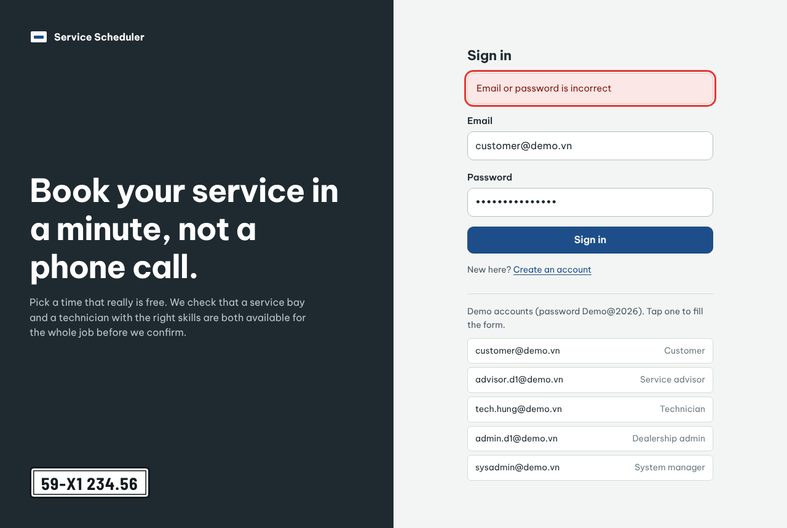

### TC-AUTH-03 Register a customer account

**Role:** new customer · **Precondition:** signed out.

| Step | Action | Expected result | Result |
| --- | --- | --- | --- |
| 1 | Click **Create an account** | The **Create your account** form opens | ☐ Pass ☐ Fail |
| 2 | Name `Nguyễn Thị Thử`, Email `tester@demo.vn`, Phone `0912 345 678`, Password `onlyletters`, click **Create account** | A red message **Password must contain a digit** appears. No account is created | ☐ Pass ☐ Fail |
| 3 | Change Password to `Tester@2026`, click **Create account** | You are signed in and land on Home: **Hi Thử, what does your bike need?** The top-right corner shows `Nguyễn Thị Thử · Customer`. "Coming up" says no appointments are booked | ☐ Pass ☐ Fail |

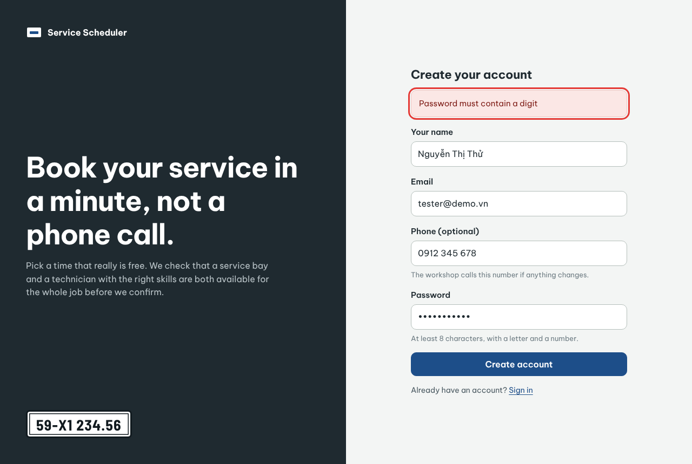

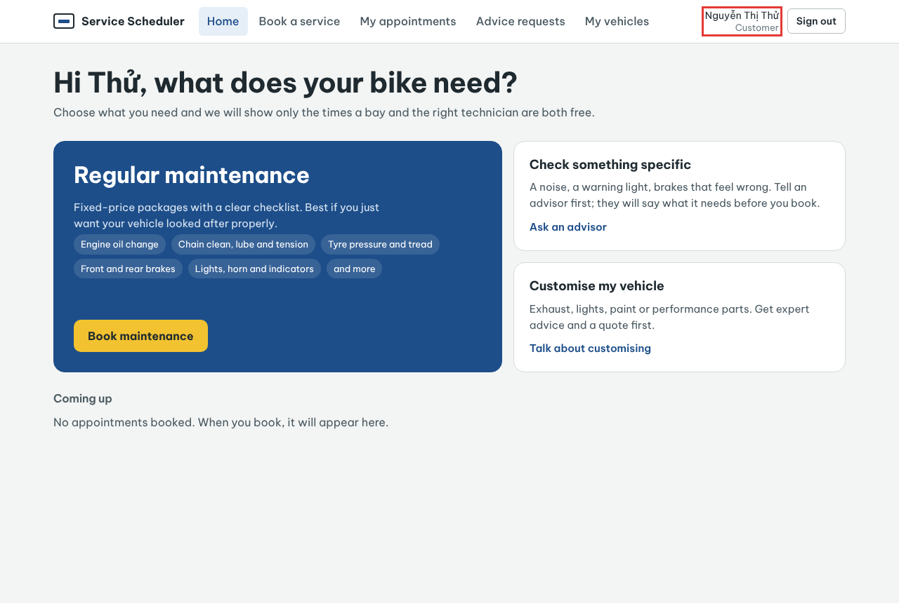

### TC-CUS-01 Add a vehicle

**Role:** the new customer from TC-AUTH-03 · **Precondition:** signed in as `tester@demo.vn`.

| Step | Action | Expected result | Result |
| --- | --- | --- | --- |
| 1 | Click **My vehicles** in the top bar | **No vehicles yet** with a button **Add your first vehicle** | ☐ Pass ☐ Fail |
| 2 | Click **Add your first vehicle**. Type Motorbike, Make `Honda`, Model `Vision`, Plate `59-K1 111.22`, Year `2024`, Mileage `1200`, VIN `ABC123`. Click **Add vehicle** | Red message **A VIN has 17 characters and never uses I, O or Q**. The vehicle is not added | ☐ Pass ☐ Fail |
| 3 | Clear the VIN field and click **Add vehicle** | The form closes and the list shows **Honda Vision**, plate `59-K1 111.22`, "Motorbike · 2024 · 1,200 km", with a **Book a service** button | ☐ Pass ☐ Fail |

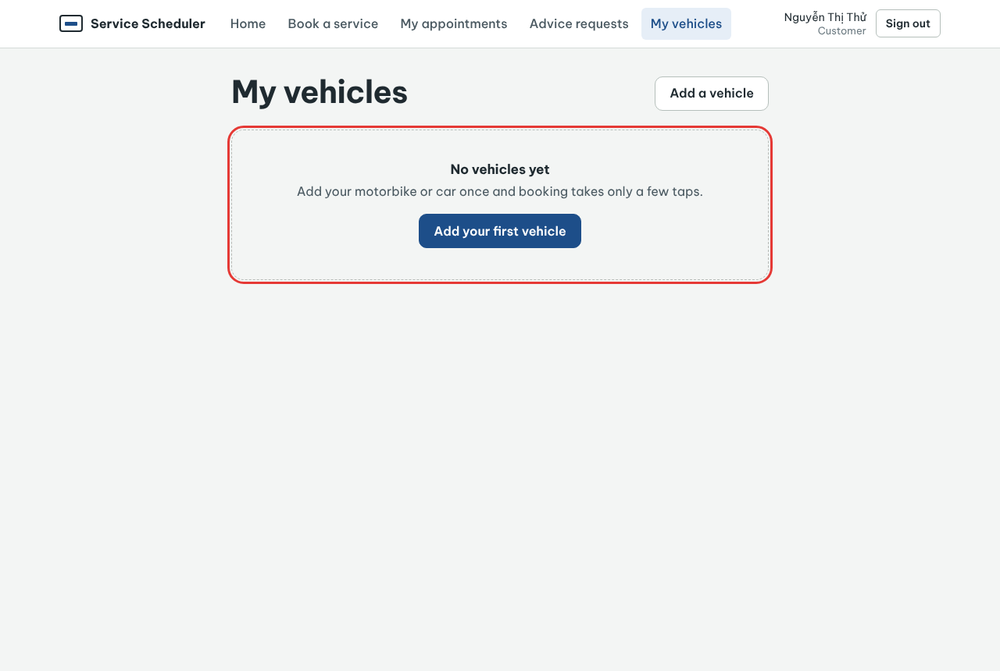

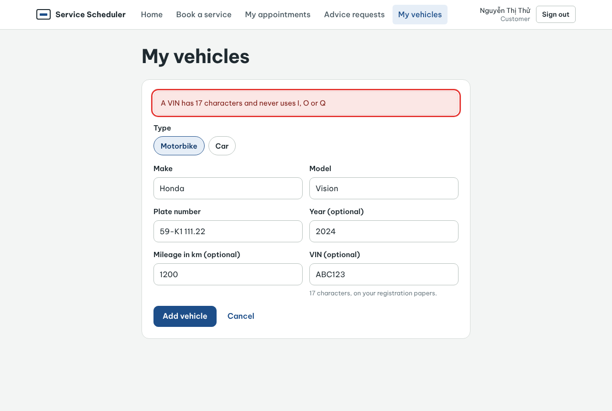

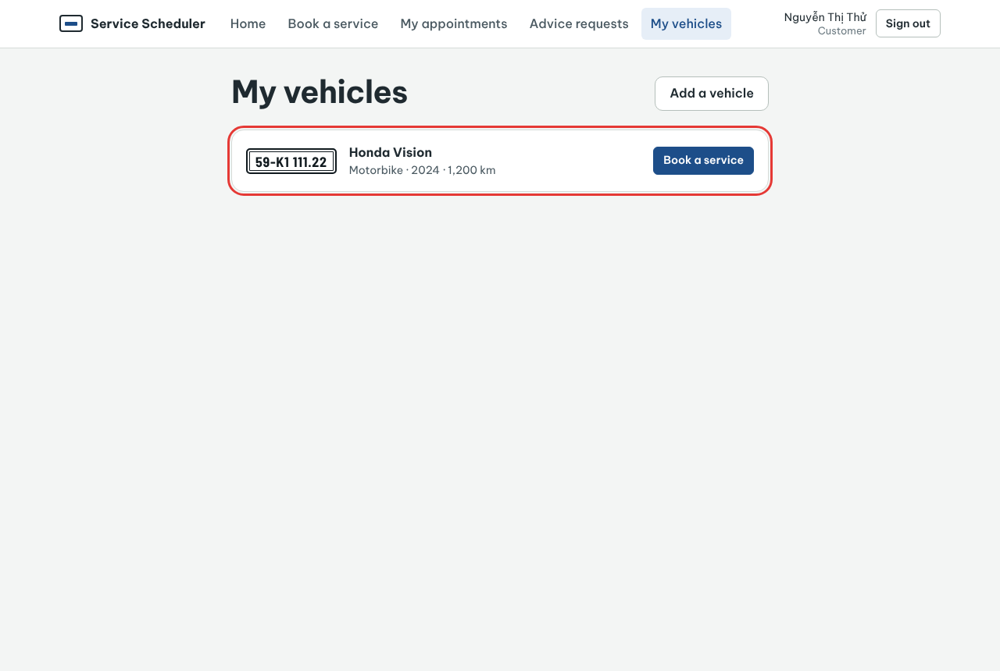

### TC-AUTH-04 Sign out

**Role:** any signed-in user.

| Step | Action | Expected result | Result |
| --- | --- | --- | --- |
| 1 | Click **Sign out** (top right) | The sign-in page appears | ☐ Pass ☐ Fail |
| 2 | Press the browser's Back button | You stay on the sign-in page; the previous page is not shown again (the token was revoked on the server) | ☐ Pass ☐ Fail |

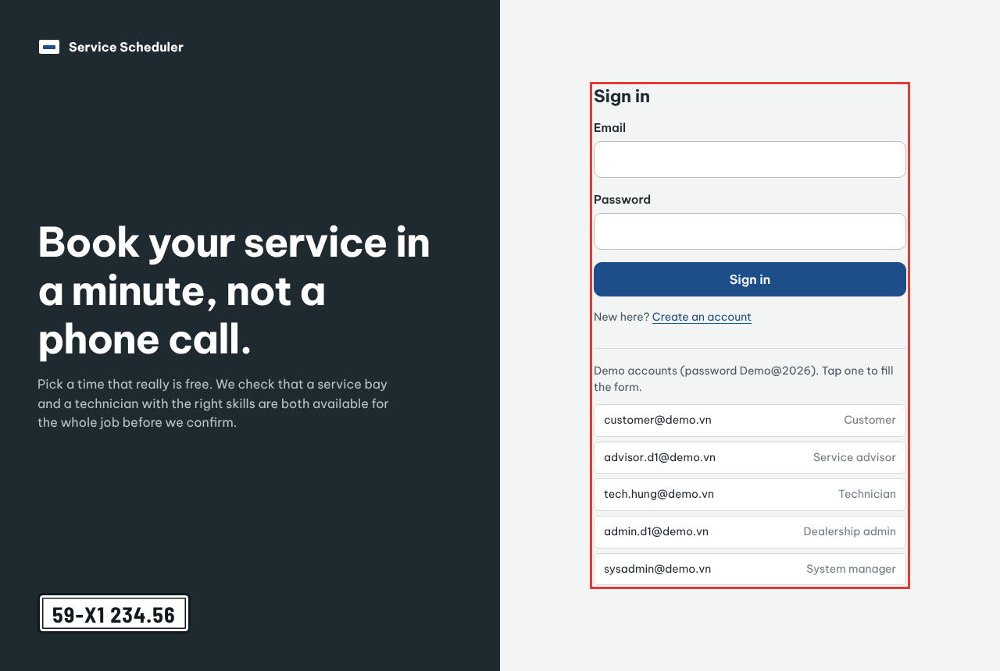

## 6. Customer

Sign in as **`customer@demo.vn`** for TC-CUS-02 to TC-CUS-09.

### TC-CUS-02 Home page

| Step | Action | Expected result | Result |
| --- | --- | --- | --- |
| 1 | Sign in as `customer@demo.vn` | Home shows **Hi Tuấn, what does your bike need?** A green banner says **Bùi Ngọc Anh has replied to your request CR-…** with a **Pick a time** button (the seeded approved customisation). Three cards: **Regular maintenance** (with the checklist of the recommended package), **Check something specific**, **Customise my vehicle**. "Coming up" says no appointments are booked, and "One request is waiting for an advisor" | ☐ Pass ☐ Fail |

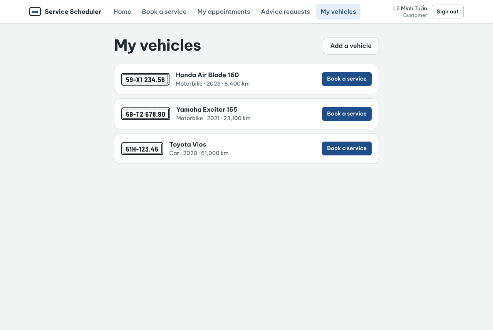

### TC-CUS-03 Book a maintenance package

This is the main customer journey.

| Step | Action | Expected result | Result |
| --- | --- | --- | --- |
| 1 | Click **Book a service** in the top bar | Step 1 **Vehicle** is current. **Which vehicle?** lists the three vehicles with their plates. The **Service ticket** on the right is a draft with nothing chosen | ☐ Pass ☐ Fail |
| 2 | Click **Honda Air Blade 160** | Step 2 **Service** opens. Only motorbike packages are listed, the recommended one first: Essential maintenance (250.000 đ, 1 h), Full periodic service, Pre-trip safety check, Brake service. **Choose a time** is disabled. The ticket shows the plate `59-X1 234.56` | ☐ Pass ☐ Fail |
| 3 | Click **Essential maintenance** | The package is selected and its checklist opens (engine oil change, chain, tyres, brakes, lights, battery). The ticket shows Service = Essential maintenance, About 1 h, Price 250.000 đ. **Choose a time** is enabled | ☐ Pass ☐ Fail |
| 4 | Click **Choose a time**, then **Saigon Moto Care – District 1** | Step 3 **Place & time**. Under **When?** the day strip opens on D+1 (the first day with a free time). Start times are grouped into Morning and Afternoon. On D+1: 08:30 and 09:00 show **1 place left**; 09:30, 10:00 and 10:30 are greyed out and show **Full** (the 10:00 walk-ins use every motorbike stand); the other times are free | ☐ Pass ☐ Fail |
| 5 | Click **11:00** | 11:00 is highlighted in yellow. The ticket shows When = D+1, 11:00, "Ready by about 12:00". **Review booking** is enabled | ☐ Pass ☐ Fail |
| 6 | Click **Review booking**. Type in the note: `The front brake squeaks when it rains.` | Step 4 **Confirm**: "We will hold a bay and a technician for you from 11:00 to 12:00. You can cancel any time before then." The ticket shows the full summary | ☐ Pass ☐ Fail |
| 7 | Click **Confirm booking** | **You're booked in** with a reference `SV-XXXXXX`, the date and time, the dealership and the technician's name. The ticket header changes from Draft to **Confirmed** | ☐ Pass ☐ Fail |
| 8 | Click **Add to calendar** | The browser downloads `service-SV-XXXXXX.ics`. Opening it adds a one-hour event at 11:00 at District 1 | ☐ Pass ☐ Fail |

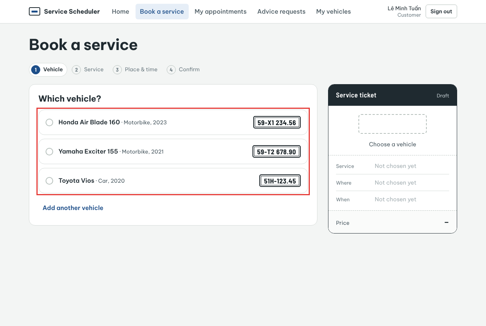

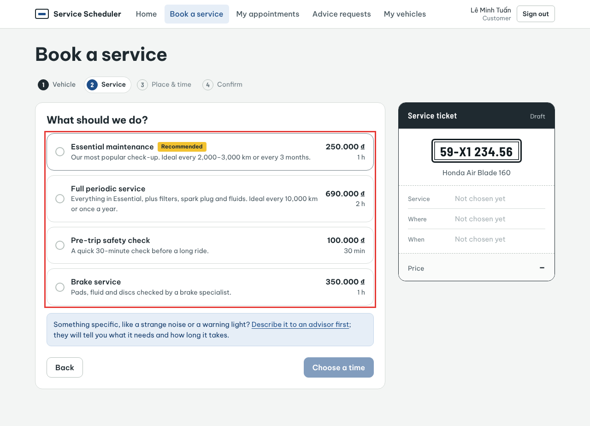

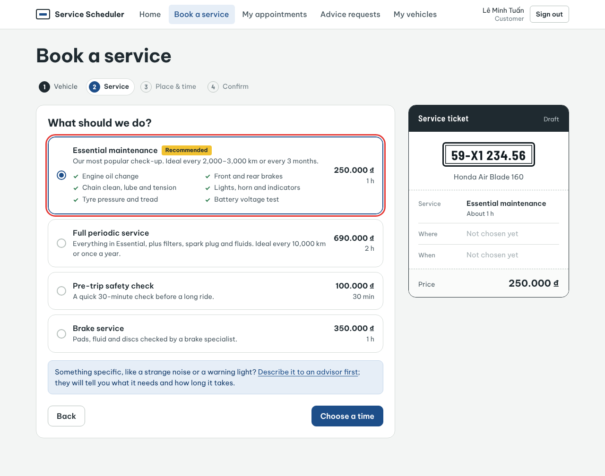

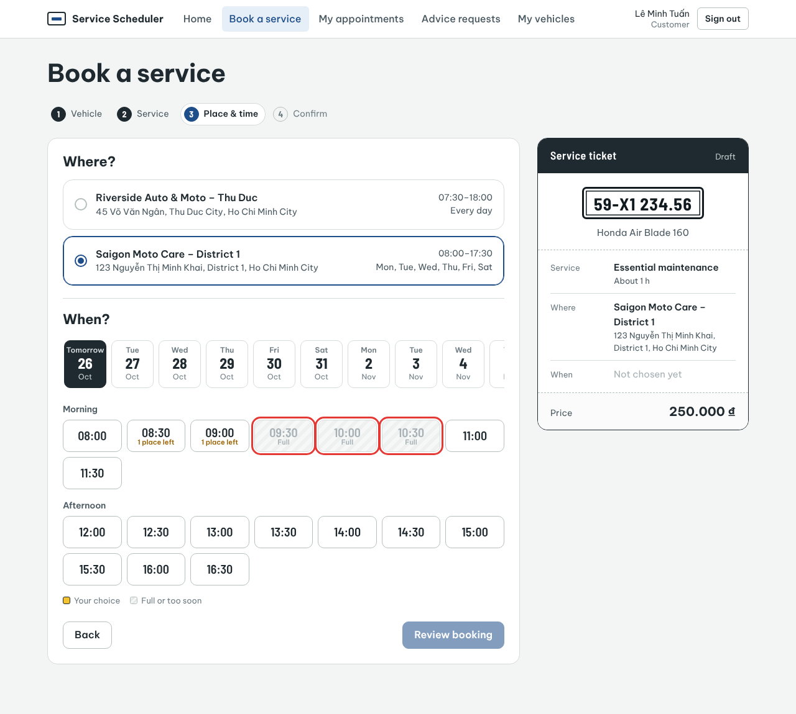

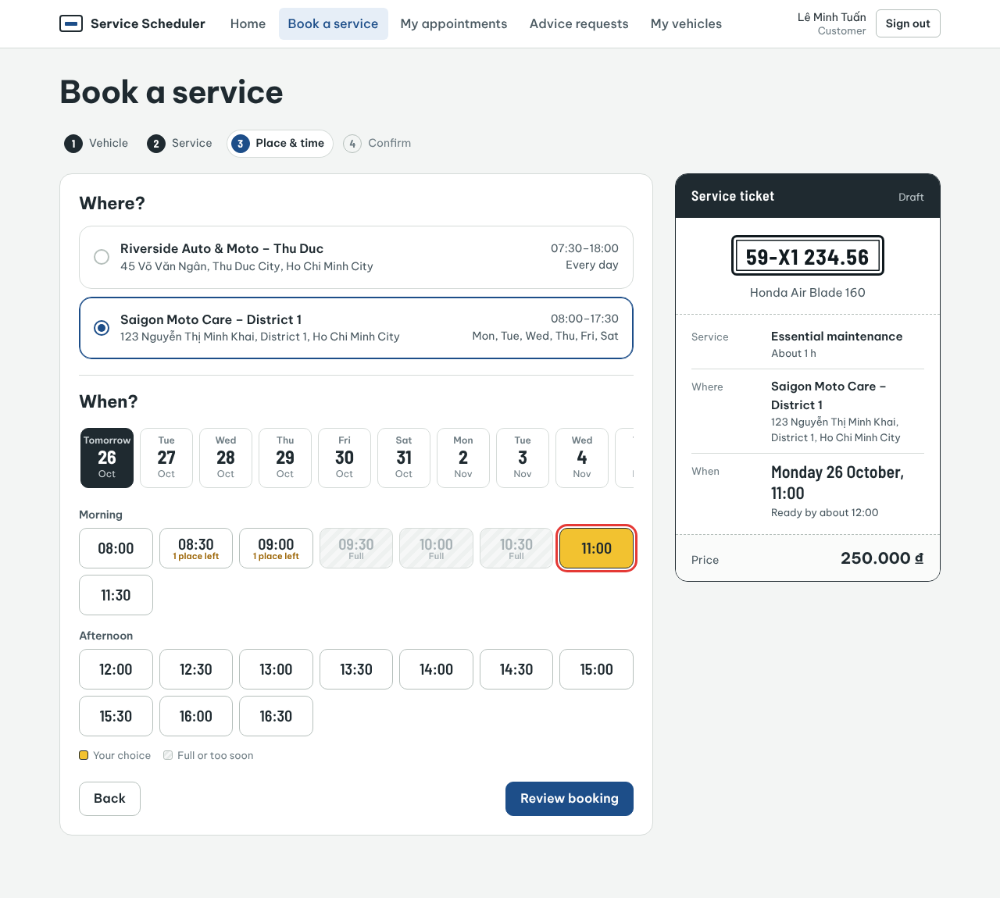

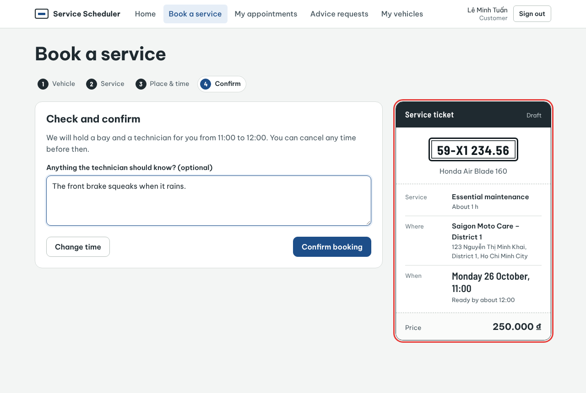

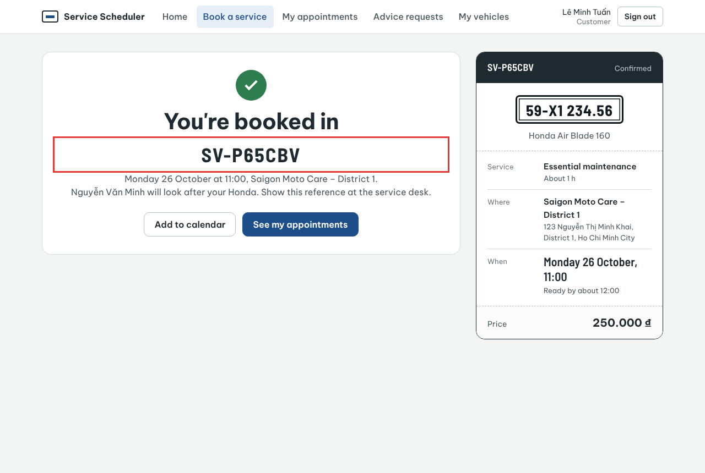

### TC-CUS-04 Slot taken during checkout

Shows that two people can never get the last place, and that the loser is offered the nearest
free times. You need two browser windows: a normal one signed in as `customer@demo.vn` and a
private (incognito) one for the second customer.

| Step | Action | Expected result | Result |
| --- | --- | --- | --- |
| 1 | Window 1 (customer): **Book a service** → **Yamaha Exciter 155** → **Essential maintenance** → **Choose a time** → **District 1** | D+1 opens. **09:00** shows **1 place left** | ☐ Pass ☐ Fail |
| 2 | Window 1: click **09:00**, then **Review booking**. Do **not** confirm yet | The confirm step shows 09:00 to 10:00 | ☐ Pass ☐ Fail |
| 3 | Window 2 (private): sign in as `walkin3@demo.vn`, book **Honda SH Mode** → **Essential maintenance** → **District 1** → D+1 **09:00** → **Confirm booking** | Window 2 shows **You're booked in**. This took the last place at 09:00 | ☐ Pass ☐ Fail |
| 4 | Window 1: click **Confirm booking** | A red message **Someone booked 09:00 a moment ago. These are the nearest free times:** with three buttons (in the screenshot 08:00, 11:00 and 11:30 on D+1). **Confirm booking** is disabled. No second booking was made at 09:00 | ☐ Pass ☐ Fail |
| 5 | Window 1: click the first alternative, then **Confirm booking** | **You're booked in** at the alternative time | ☐ Pass ☐ Fail |

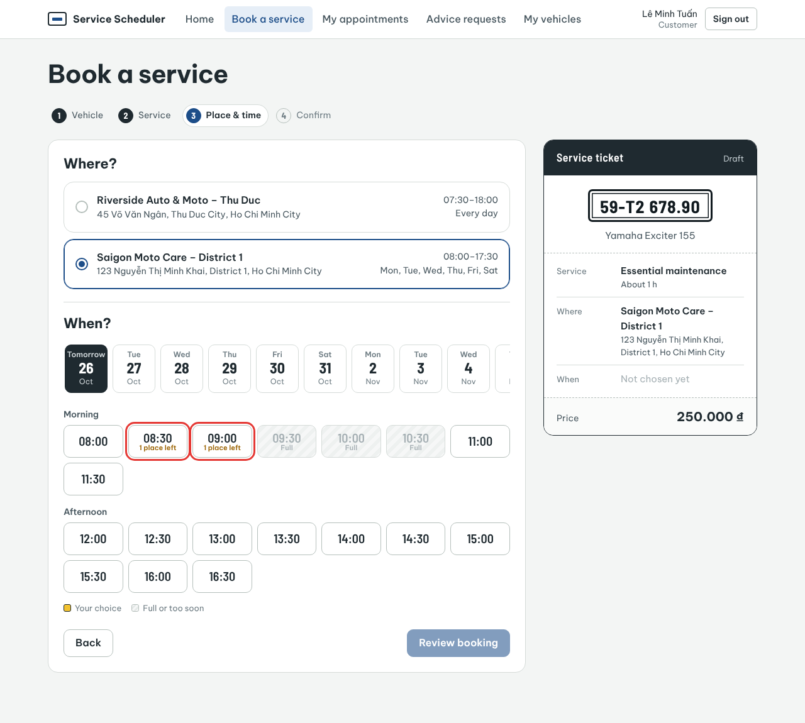

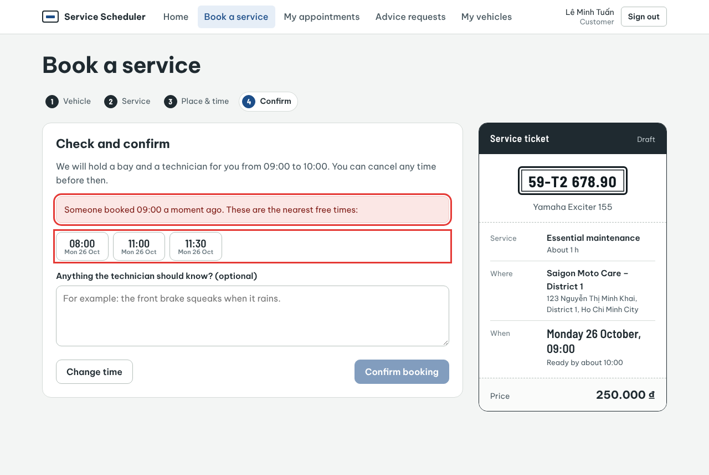


The same rule is proved under load by the automated tests: 50 simultaneous requests for one slot
(`BookingConcurrencySpec`) and 1000 simultaneous HTTP requests (`sbt loadTest`), where exactly as
many bookings succeed as there are free bay and technician pairs.

### TC-CUS-05 A dealership that cannot do the job

| Step | Action | Expected result | Result |
| --- | --- | --- | --- |
| 1 | **Book a service** → **Toyota Vios** → **Minor service** → **Choose a time** → **District 1** | Under **When?** a notice: **Saigon Moto Care – District 1 cannot do this job: it has no car lift or no technician with the right skills. Please choose another dealership.** No times are offered and **Review booking** stays disabled | ☐ Pass ☐ Fail |
| 2 | Choose **Riverside Auto & Moto – Thu Duc** instead | Times are offered (Thu Duc has car lifts) | ☐ Pass ☐ Fail |

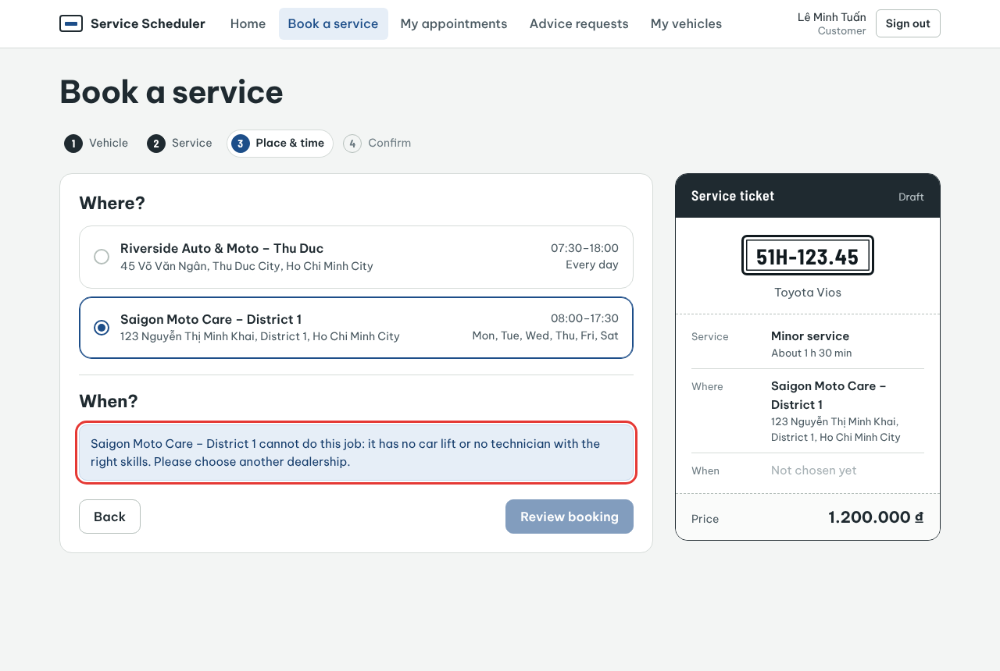

### TC-CUS-06 View and cancel an appointment

| Step | Action | Expected result | Result |
| --- | --- | --- | --- |
| 1 | Click **My appointments** | **Upcoming** lists the two bookings from TC-CUS-03 and TC-CUS-04, each with status **Confirmed**, date and time, dealership, vehicle, technician, price and reference, and the buttons **Add to calendar** and **Cancel** | ☐ Pass ☐ Fail |
| 2 | On the Exciter booking (`59-T2 678.90`) click **Cancel** | The button changes to **Yes, cancel it** and **Keep it**. Nothing is cancelled yet | ☐ Pass ☐ Fail |
| 3 | Click **Yes, cancel it** | The booking moves to **Past and cancelled** with status **Cancelled**. Its time becomes free again for other customers | ☐ Pass ☐ Fail |

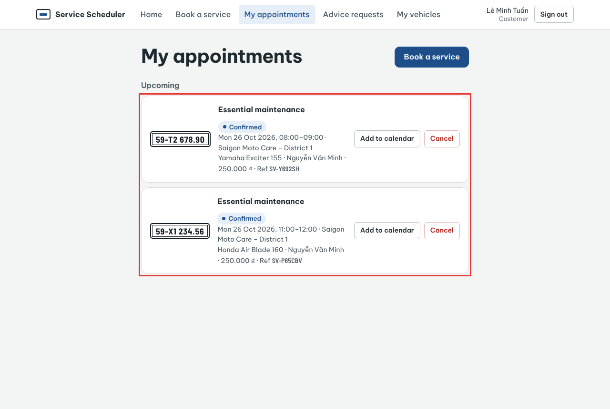

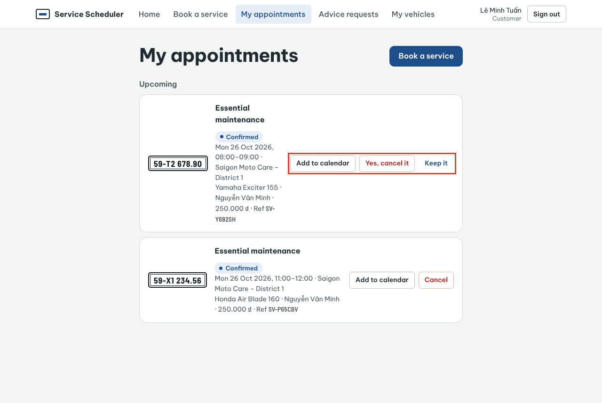

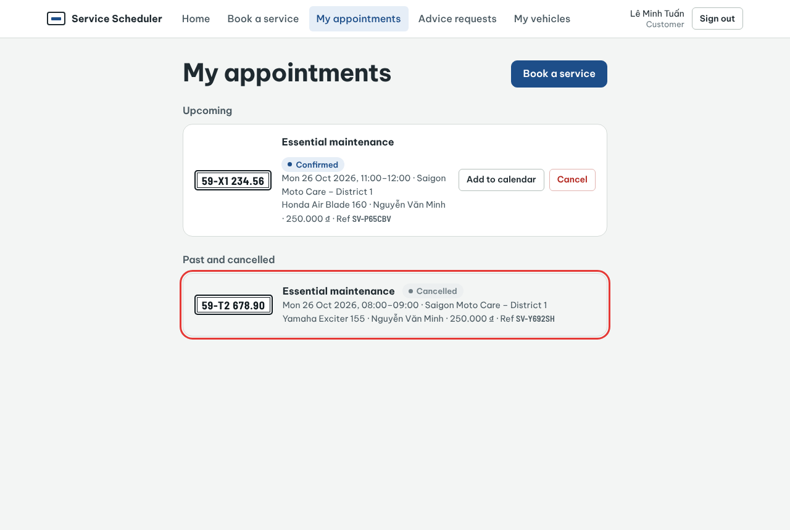

A customer cannot cancel once the start time has passed (the API answers `409` with code
`TOO_LATE_TO_CANCEL`, and the button is hidden). This needs real time to pass, so it is covered by the
automated tests `LifecycleSpec` › "lets a customer cancel only before the start time" and `ApiSpec` › "lets the customer cancel before the start, which frees the slot".

### TC-CUS-07 Ask for an inspection

| Step | Action | Expected result | Result |
| --- | --- | --- | --- |
| 1 | **Home** → **Check something specific** | The form **Check something specific**. **Send to an advisor** is disabled until a vehicle, at least one area and a description of 10+ characters are given | ☐ Pass ☐ Fail |
| 2 | Vehicle **Honda Air Blade 160**, area **Brakes**, description `The rear brake makes a grinding noise and the lever feels soft.`, dealership **Saigon Moto Care – District 1** | The form is complete and the button is enabled | ☐ Pass ☐ Fail |
| 3 | Click **Send to an advisor** | **Advice requests** opens with a green message **Sent. An advisor usually replies within a working day, and the reply will appear here.** The new inspection is listed with status **Waiting for an advisor** and a **Withdraw request** button | ☐ Pass ☐ Fail |

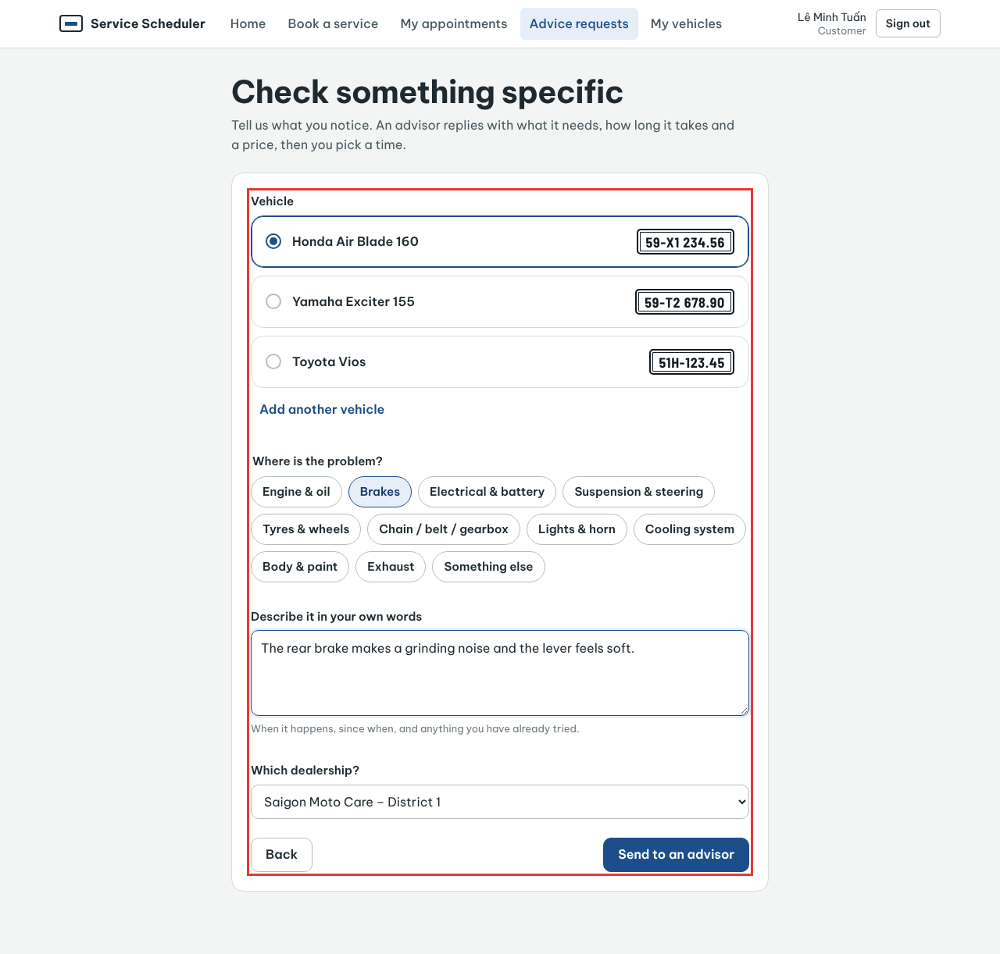

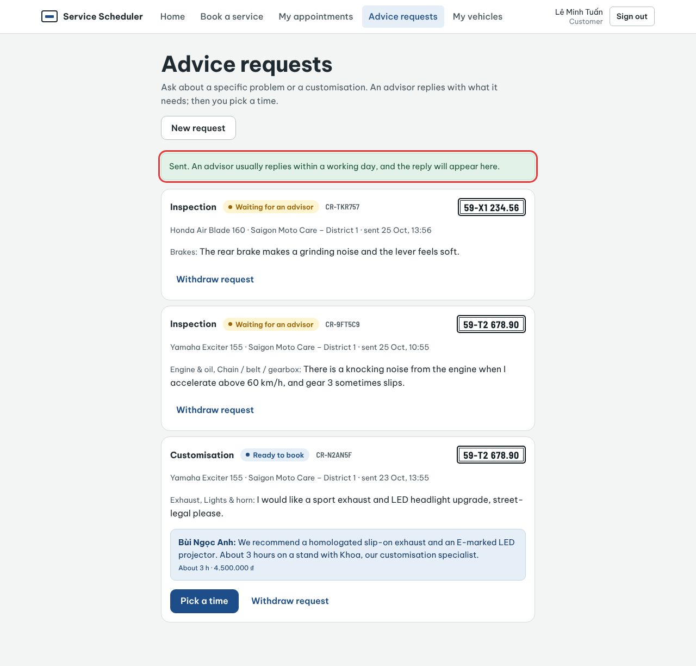

### TC-CUS-08 Ask for a customisation, then withdraw it

| Step | Action | Expected result | Result |
| --- | --- | --- | --- |
| 1 | **Home** → **Customise my vehicle** | The form **Customise my vehicle**, asking "What would you like to change?" | ☐ Pass ☐ Fail |
| 2 | Vehicle **Toyota Vios**, area **Lights & horn**, description `Brighter LED headlights that are still street-legal.`, dealership **Riverside Auto & Moto – Thu Duc**, click **Send to an advisor** | The request is listed as **Customisation** with status **Waiting for an advisor** | ☐ Pass ☐ Fail |
| 3 | On that request click **Withdraw request** | Its status becomes **Withdrawn** and its buttons disappear | ☐ Pass ☐ Fail |

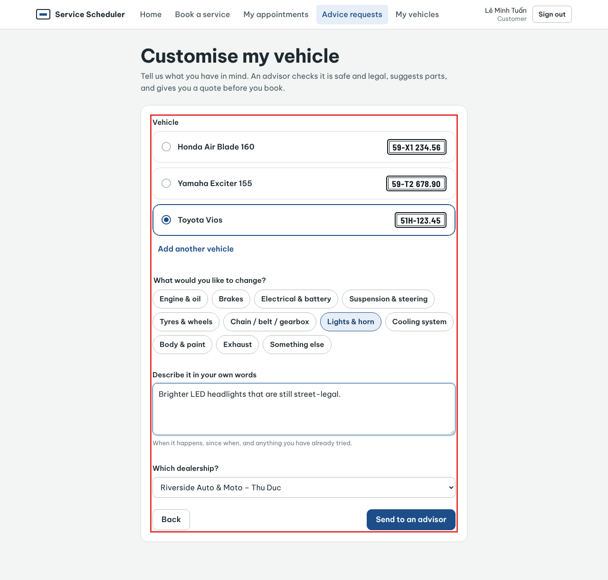

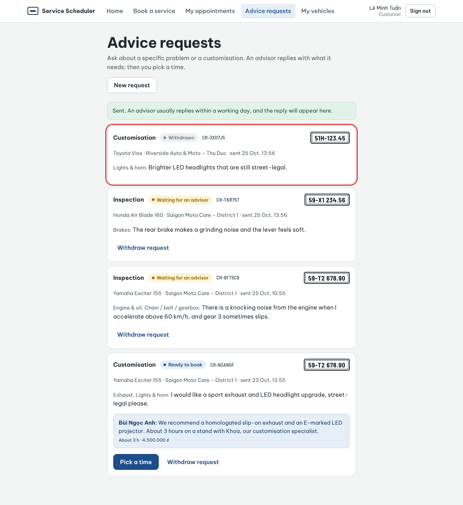

### TC-CUS-09 Book a request the advisor approved

| Step | Action | Expected result | Result |
| --- | --- | --- | --- |
| 1 | On **Advice requests**, find the **Customisation** with status **Ready to book** (sport exhaust) | The advisor's reply is shown: "We recommend a homologated slip-on exhaust and an E-marked LED projector…", **About 3 h · 4.500.000 đ**, and a **Pick a time** button | ☐ Pass ☐ Fail |
| 2 | Click **Pick a time** | **Pick a time for your request**: "Bùi Ngọc Anh approved request CR-…: about 3 h at Saigon Moto Care – District 1." Only two steps (Time, Confirm): vehicle, service and dealership are fixed by the request. The day strip opens on the first day the customisation specialist (Phạm Đức Khoa, Tue–Sat from 09:00) is free; in the screenshot that is Tuesday | ☐ Pass ☐ Fail |
| 3 | Click the first free time, **Review booking**, **Confirm booking** | **You're booked in**. The text names **Phạm Đức Khoa** as the technician. Price 4.500.000 đ | ☐ Pass ☐ Fail |
| 4 | Open **Advice requests** | The customisation now has status **Booked** and a button "Booked for <day> at <time>" | ☐ Pass ☐ Fail |

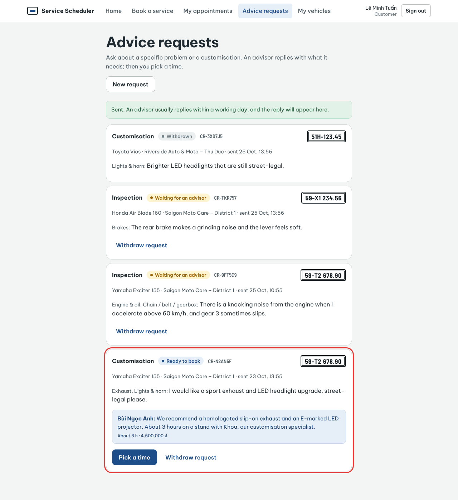

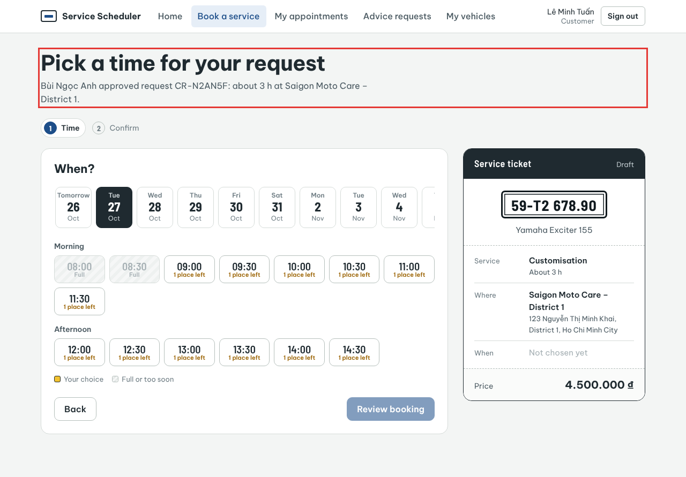

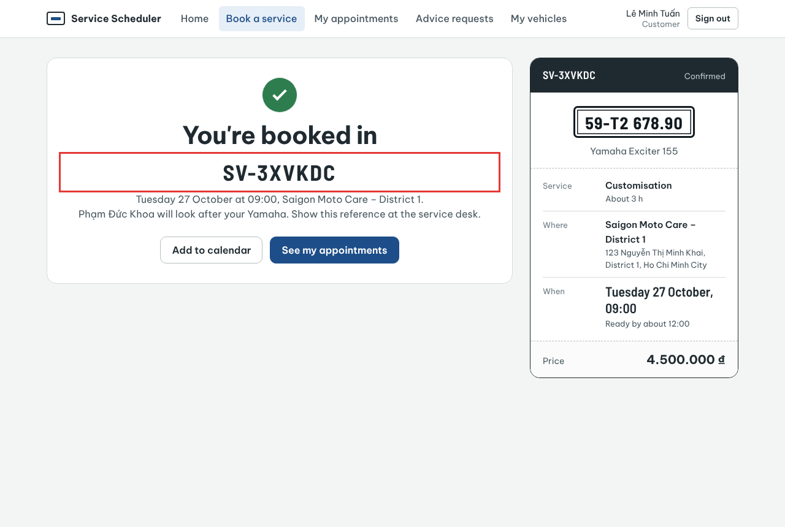

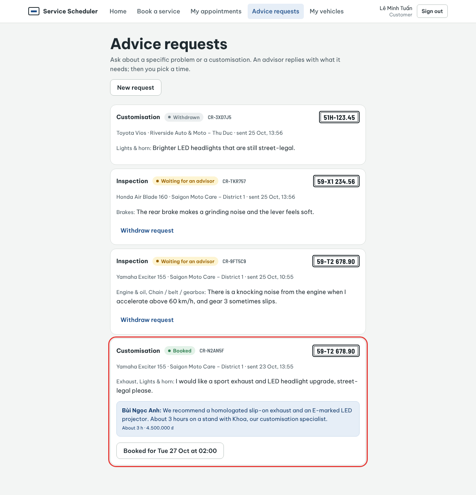

### TC-AUTH-05 A customer cannot open staff pages

| Step | Action | Expected result | Result |
| --- | --- | --- | --- |
| 1 | Still signed in as the customer, type <http://localhost:5173/admin> in the address bar | You are sent back to **Home**. The top bar only has customer links | ☐ Pass ☐ Fail |
| 2 | Click **Sign out** | The sign-in page appears | ☐ Pass ☐ Fail |

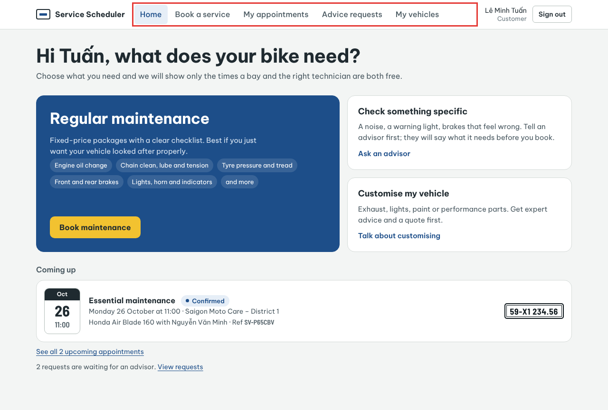

The API enforces the same rule on its own (TC-API-02), so hiding a link is not the only protection.

## 7. Technician

Run this before the advisor section, so that the advisor does not move the technician's jobs
first. Sign in as **`tech.hung@demo.vn`**.

### TC-TEC-01 My jobs by day

| Step | Action | Expected result | Result |
| --- | --- | --- | --- |
| 1 | Sign in as `tech.hung@demo.vn` | **My jobs** opens on today. The top bar only has **My jobs**. If today is not a working day, **No jobs on this day** | ☐ Pass ☐ Fail |
| 2 | Click **›** (next day) until the date is D+1 | Two job cards: **09:00–10:00** Honda SH Mode `59-B3 100.02`, Stand C, and **10:00–11:00** Honda Lead `59-B5 100.04`, Stand C. Each shows status **Confirmed**, the package checklist and a **Start job** button | ☐ Pass ☐ Fail |

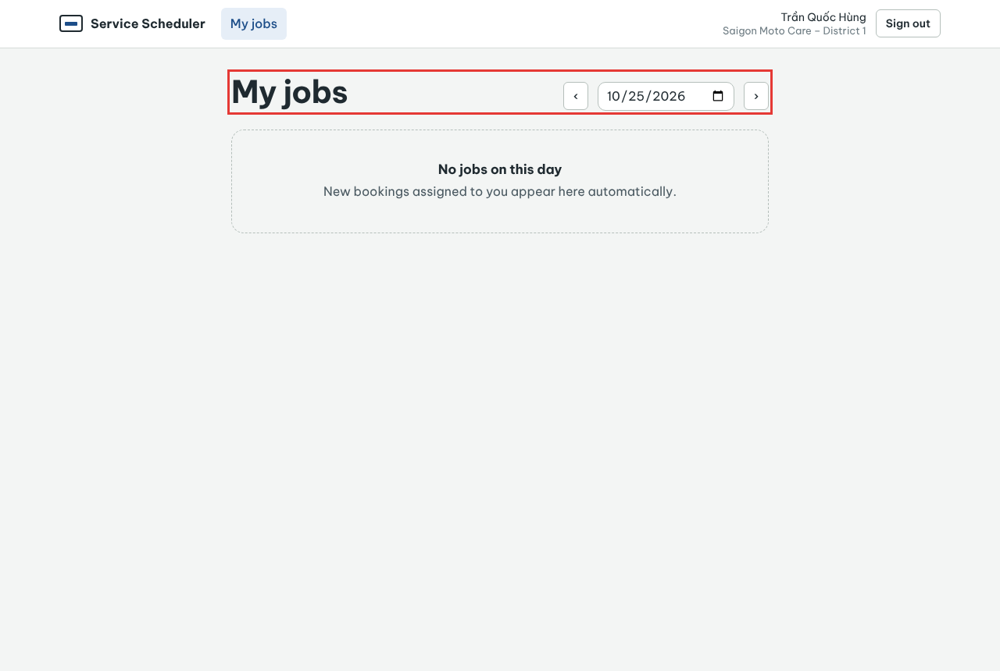

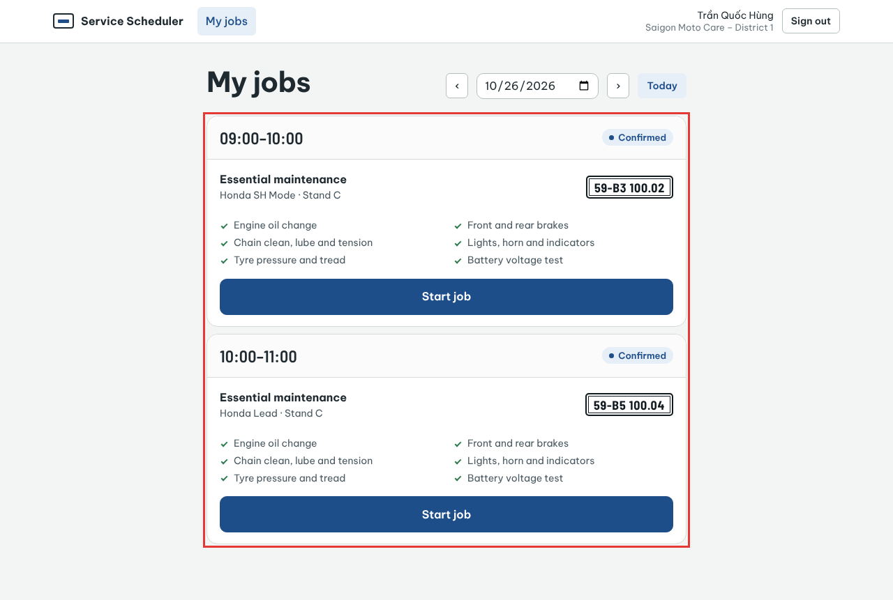

### TC-TEC-02 Start and finish a job

| Step | Action | Expected result | Result |
| --- | --- | --- | --- |
| 1 | On the 09:00 card click **Start job** | Status becomes **In the workshop** and the button becomes **Job done** | ☐ Pass ☐ Fail |
| 2 | Click **Job done** | Status becomes **Done** and the card has no more buttons | ☐ Pass ☐ Fail |

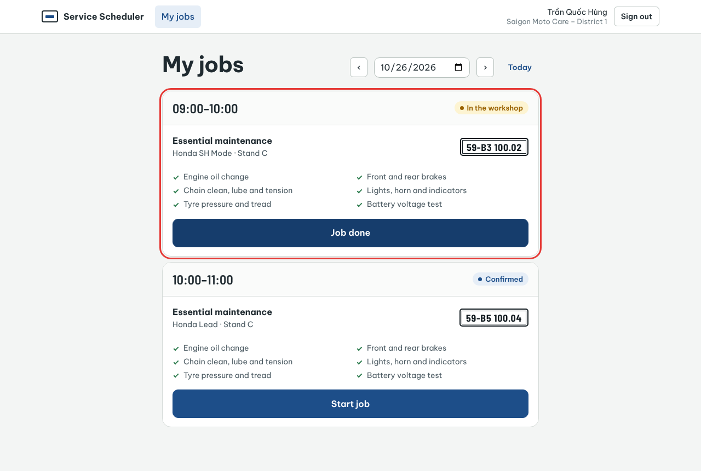

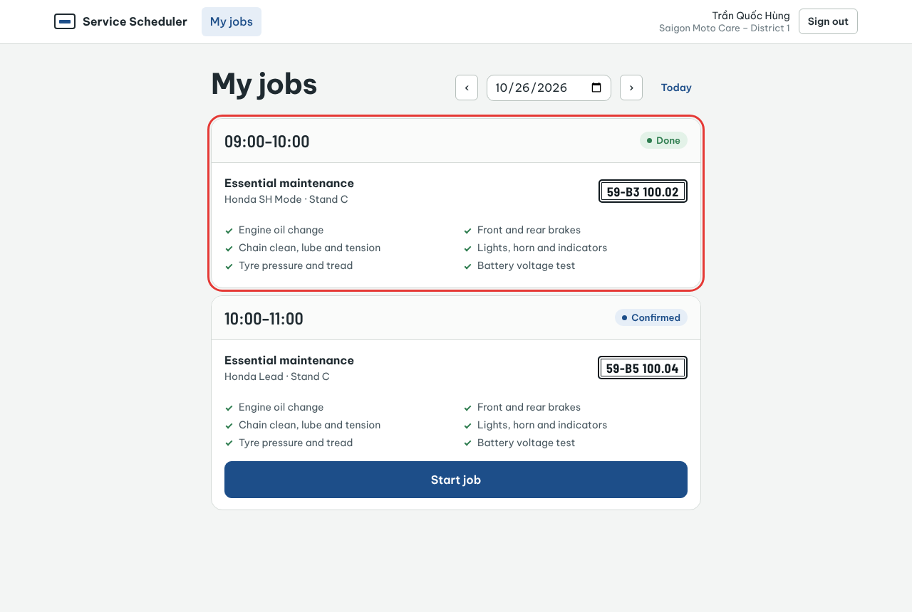

A technician can only move their own jobs; moving another technician's job answers `403`
(automated test `ApiSpec` › "UC41: a technician cannot start a job assigned to another technician").

### TC-AUTH-06 A technician cannot open the workshop board

| Step | Action | Expected result | Result |
| --- | --- | --- | --- |
| 1 | Type <http://localhost:5173/staff/board> in the address bar | You are sent back to **My jobs** | ☐ Pass ☐ Fail |
| 2 | Click **Sign out** | The sign-in page appears | ☐ Pass ☐ Fail |

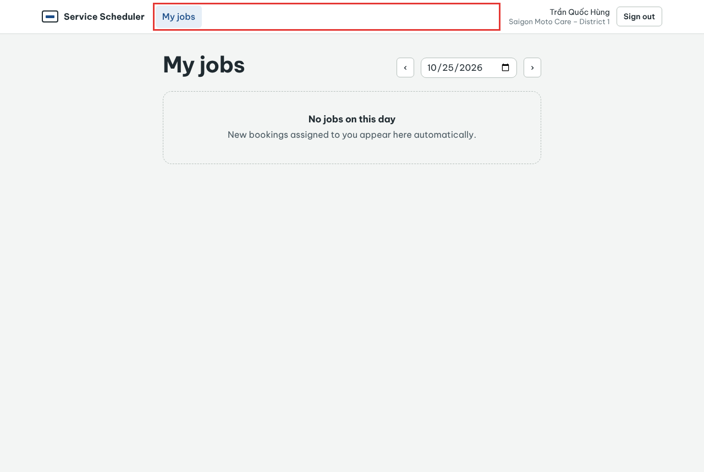

## 8. Service advisor

Sign in as **`advisor.d1@demo.vn`**.

### TC-ADV-01 Workshop day board

| Step | Action | Expected result | Result |
| --- | --- | --- | --- |
| 1 | Sign in as `advisor.d1@demo.vn` | **Workshop day** for **Saigon Moto Care – District 1**, today. One row per bay (Diagnostic 1, Stand A, B, C) against the opening hours. A red line marks the current time when today is open | ☐ Pass ☐ Fail |
| 2 | Click **›** until the date is D+1 | The header counts the day's jobs (8 in the screenshot), in progress and done. Each job is a block in its bay's row at its time, showing the plate, start time and technician. The right-hand list **Jobs today** lists every job with its status, including the customer's 11:00 booking, the 09:00 job Hùng finished (**Done**) and the cancelled Exciter booking (**Cancelled**) | ☐ Pass ☐ Fail |

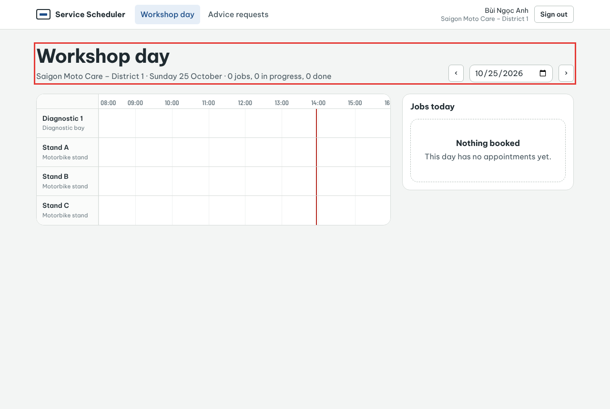

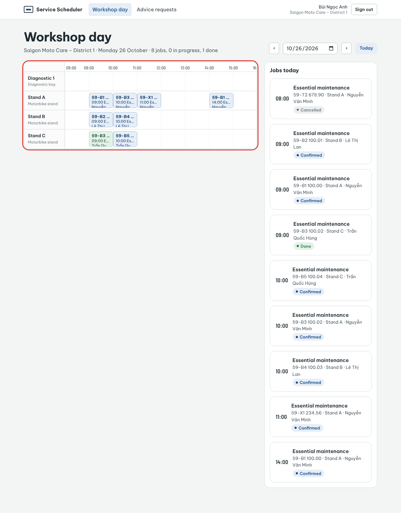

### TC-ADV-02 Job details

| Step | Action | Expected result | Result |
| --- | --- | --- | --- |
| 1 | Click the 11:00 block with plate `59-X1 234.56` | The side panel shows the reference, plate, status **Confirmed**, time 11:00–12:00, service, vehicle, customer **Lê Minh Tuấn** with a clickable phone number, bay, technician, price, the customer's note **The front brake squeaks when it rains.**, the checklist, and the buttons **Vehicle arrived, start work** and **Cancel booking** | ☐ Pass ☐ Fail |
| 2 | Click **Close** | The panel goes back to the day's job list | ☐ Pass ☐ Fail |

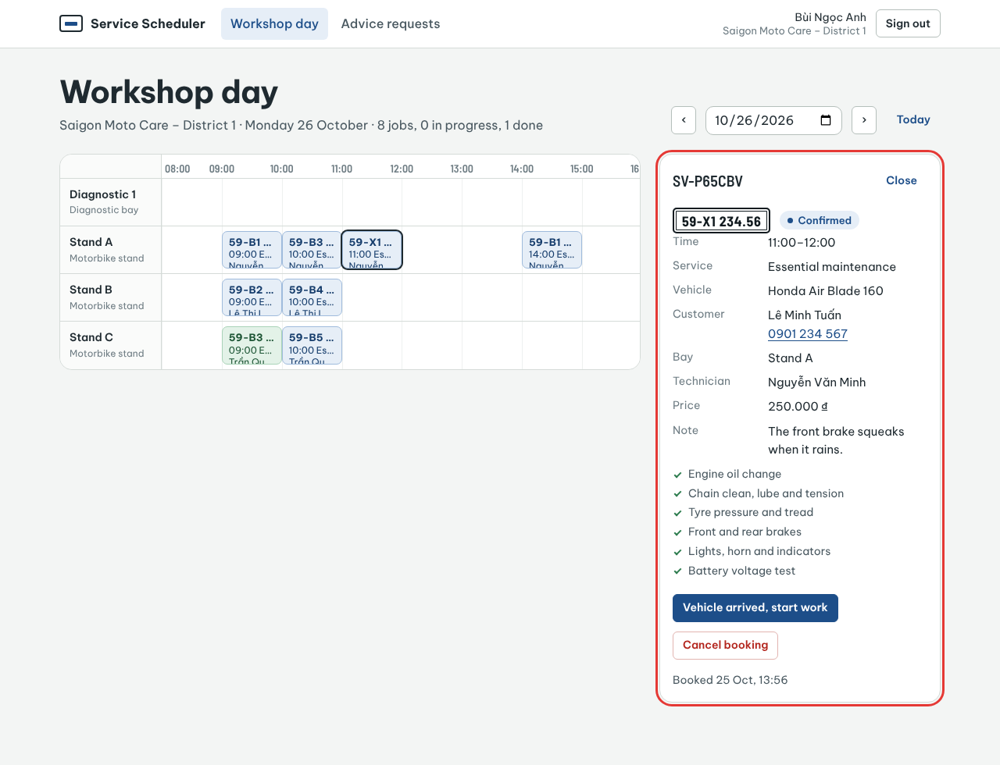

**Customer did not come** (no-show) is only offered once the start time has passed, so it is not
visible on D+1. The rule is covered by the automated test `ApiSpec` › "a no-show can only be recorded after the start time".

### TC-ADV-03 Start and finish a job from the board

| Step | Action | Expected result | Result |
| --- | --- | --- | --- |
| 1 | Click a **Confirmed** walk-in job (plate starting `59-B`) that is **not** assigned to Trần Quốc Hùng, for example the 09:00 job on Stand A | The panel shows **Vehicle arrived, start work** | ☐ Pass ☐ Fail |
| 2 | Click **Vehicle arrived, start work** | Status becomes **In the workshop**, the block turns yellow, the header count "in progress" goes up by one, and the button becomes **Mark as done** | ☐ Pass ☐ Fail |
| 3 | Click **Mark as done** | Status becomes **Done**, the block turns green, and no action buttons remain | ☐ Pass ☐ Fail |

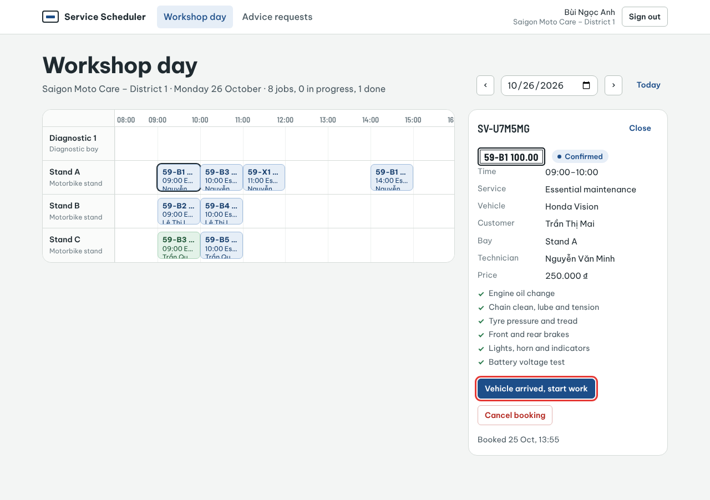

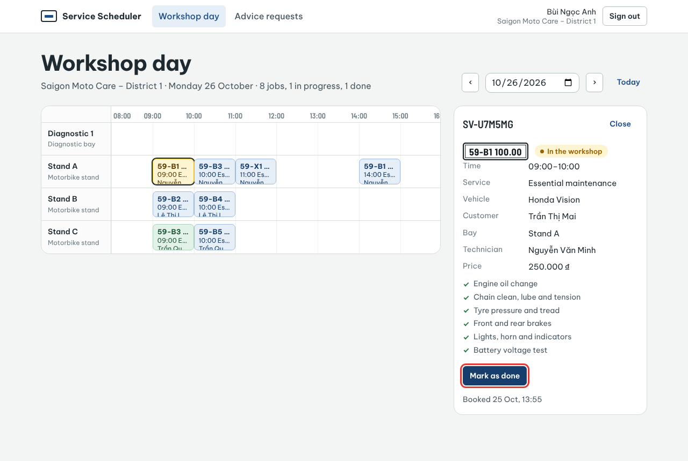

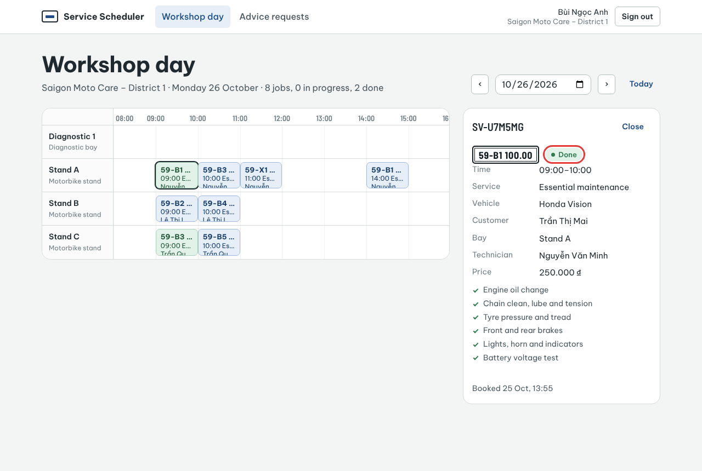

### TC-ADV-04 Cancel a booking from the board

| Step | Action | Expected result | Result |
| --- | --- | --- | --- |
| 1 | Click **Close**, then another **Confirmed** walk-in job not assigned to Hùng | The panel shows **Cancel booking** | ☐ Pass ☐ Fail |
| 2 | Click **Cancel booking** | Status becomes **Cancelled**. The block disappears from the board and the header job count goes down by one; the bay is free again at that time | ☐ Pass ☐ Fail |

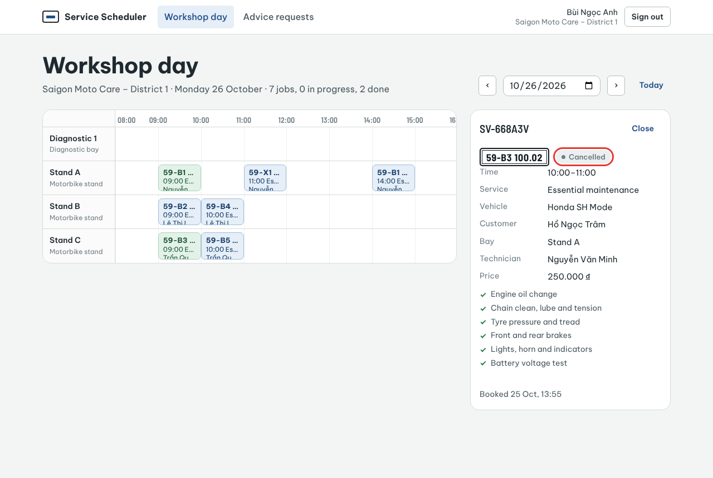

### TC-ADV-05 Approve an advice request

| Step | Action | Expected result | Result |
| --- | --- | --- | --- |
| 1 | Click **Advice requests** | Tab **Waiting for advice** with a count of **2**: the seeded Exciter inspection (knocking noise) and the Air Blade inspection from TC-CUS-07. Each card shows the customer, phone, vehicle, areas, description and a **Your advice** form | ☐ Pass ☐ Fail |
| 2 | On the Air Blade request (grinding noise): Time needed **1 h**, Skill needed **Brakes & suspension**, Bay **Motorbike stand**, Estimate `300000`, Message `Probably worn rear pads. We will replace the pads and bleed the brake fluid.` | The form is filled | ☐ Pass ☐ Fail |
| 3 | Click **Approve and let them book** | The request leaves the Waiting tab (count becomes 1). It is now under **Approved, not booked** | ☐ Pass ☐ Fail |

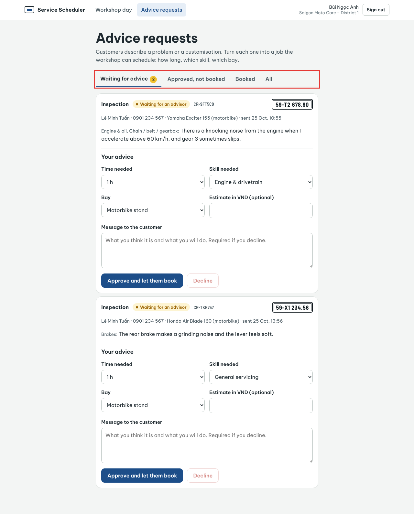

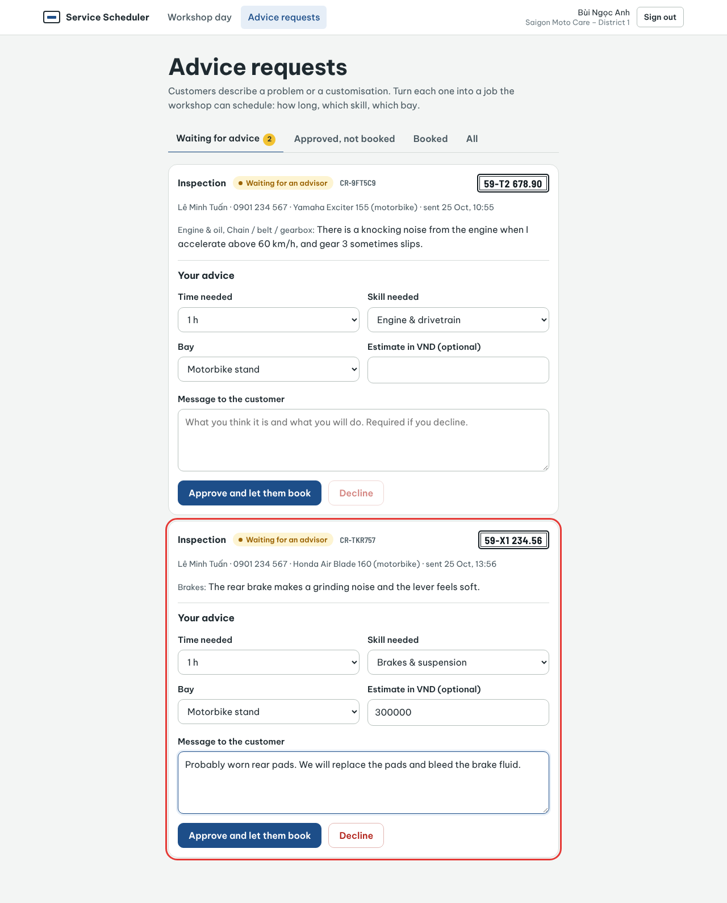

### TC-ADV-06 Decline an advice request

| Step | Action | Expected result | Result |
| --- | --- | --- | --- |
| 1 | On the Exciter request (knocking noise), leave the message empty | **Decline** is disabled: a reason of at least 5 characters is required | ☐ Pass ☐ Fail |
| 2 | Message `This needs a test ride with you present. Please bring the bike to the desk any morning.`, click **Decline** | The request leaves the Waiting tab | ☐ Pass ☐ Fail |
| 3 | Click the **All** tab | The list shows the booked customisation (**Booked**, with the booked time), the declined inspection (**Not possible**, with the reason) and the approved inspection (**Ready to book**, "1 h · BRAKES_SUSPENSION · MOTORBIKE_STAND · 300.000 đ") | ☐ Pass ☐ Fail |
| 4 | Click **Sign out** | The sign-in page appears | ☐ Pass ☐ Fail |

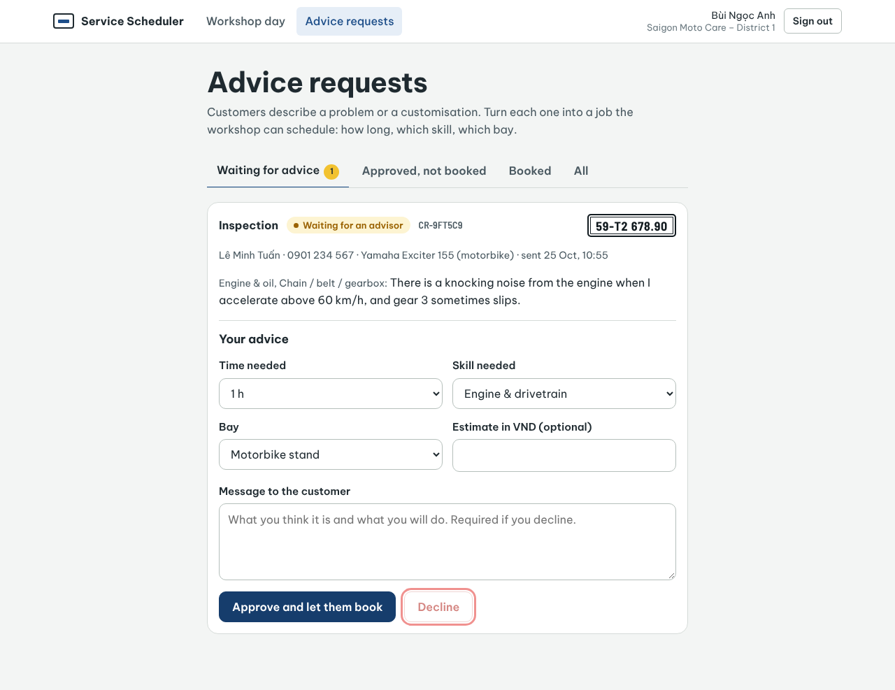

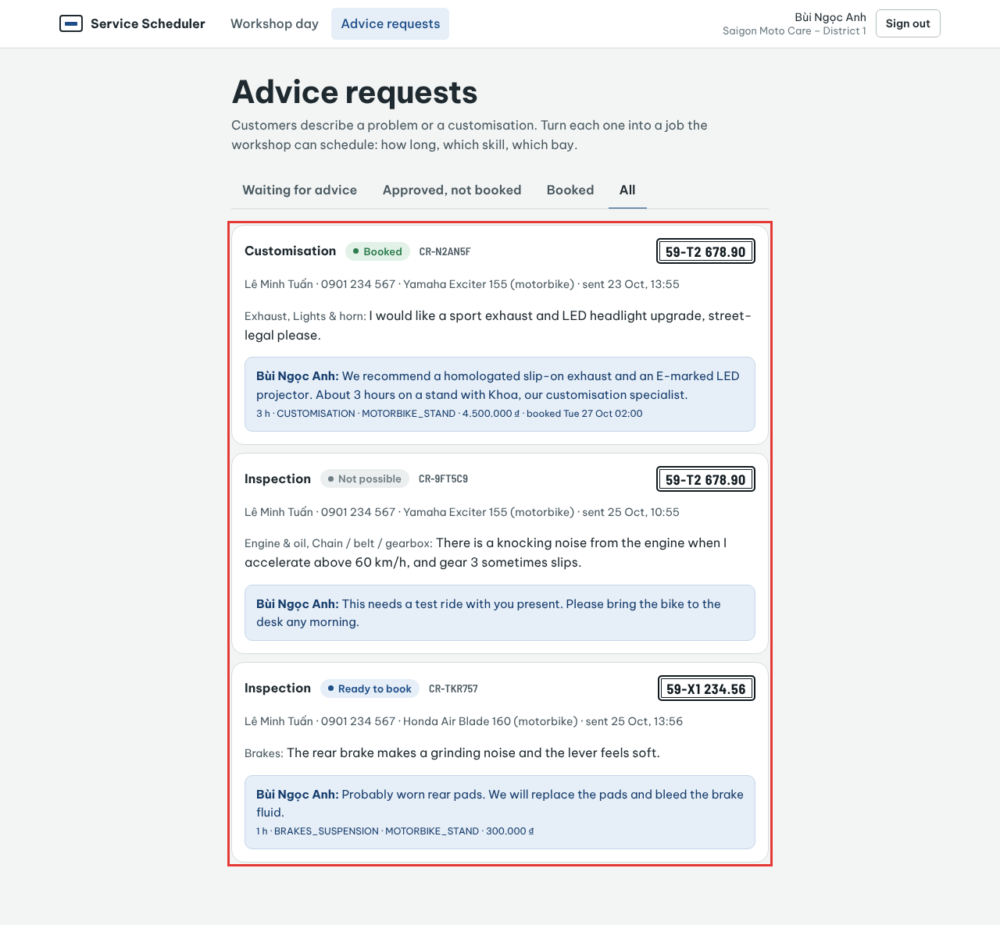

### TC-CUS-10 The customer sees the advisor's replies

| Step | Action | Expected result | Result |
| --- | --- | --- | --- |
| 1 | Sign in as `customer@demo.vn` | Home shows a green banner **Bùi Ngọc Anh has replied to your request CR-…. It takes about 1 h at Saigon Moto Care – District 1.** with **Pick a time**. "Coming up" shows the 11:00 booking | ☐ Pass ☐ Fail |
| 2 | Open **Advice requests** | The Air Blade inspection is **Ready to book** with the advisor's message and "About 1 h · 300.000 đ". The Exciter inspection is **Not possible** with the reason in red. The customisation is **Booked** | ☐ Pass ☐ Fail |
| 3 | Click **Sign out** | The sign-in page appears | ☐ Pass ☐ Fail |

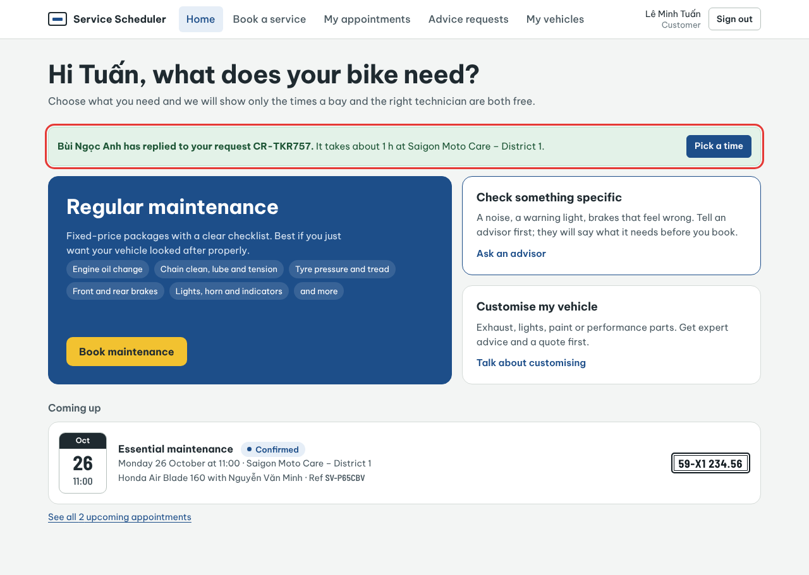

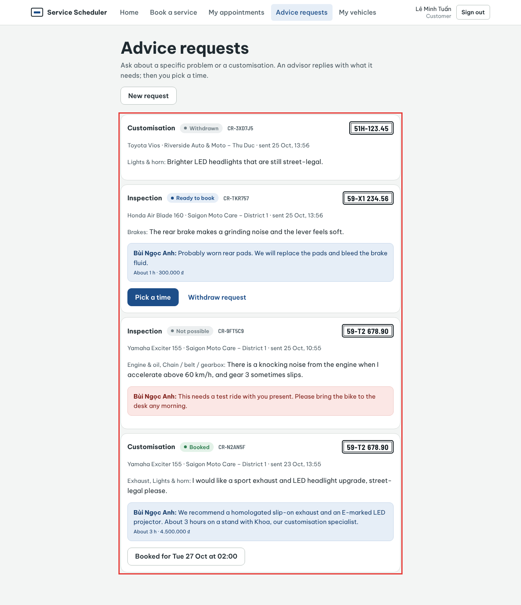

## 9. Dealership admin

Sign in as **`admin.d1@demo.vn`**.

### TC-ADM-01 Admin navigation

| Step | Action | Expected result | Result |
| --- | --- | --- | --- |
| 1 | Sign in as `admin.d1@demo.vn` | The top bar has **Workshop day**, **Advice requests** and **Bays & team**: the admin can do everything an advisor can, plus manage resources. The corner shows `Đặng Thu Hà · Saigon Moto Care – District 1` | ☐ Pass ☐ Fail |

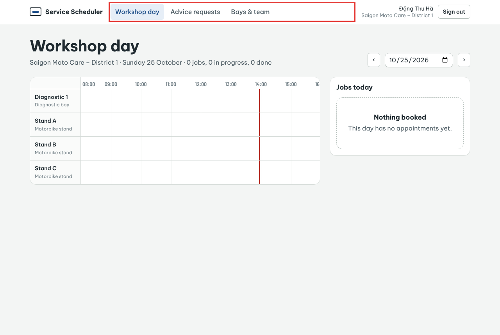

### TC-ADM-02 Add a bay and take it out of service

| Step | Action | Expected result | Result |
| --- | --- | --- | --- |
| 1 | Click **Bays & team** | Tab **Service bays**: Diagnostic 1, Stand A, B, C, all **In use**, and an **Add a bay** form | ☐ Pass ☐ Fail |
| 2 | Name `Stand D`, Type **Motorbike stand**, click **Add bay** | **Stand D · Motorbike stand · In use** appears in the table | ☐ Pass ☐ Fail |
| 3 | On Stand D click **Take out of service** | The row turns grey, status **Out of service**, button **Put back in service**. The scheduler no longer offers Stand D to customers | ☐ Pass ☐ Fail |

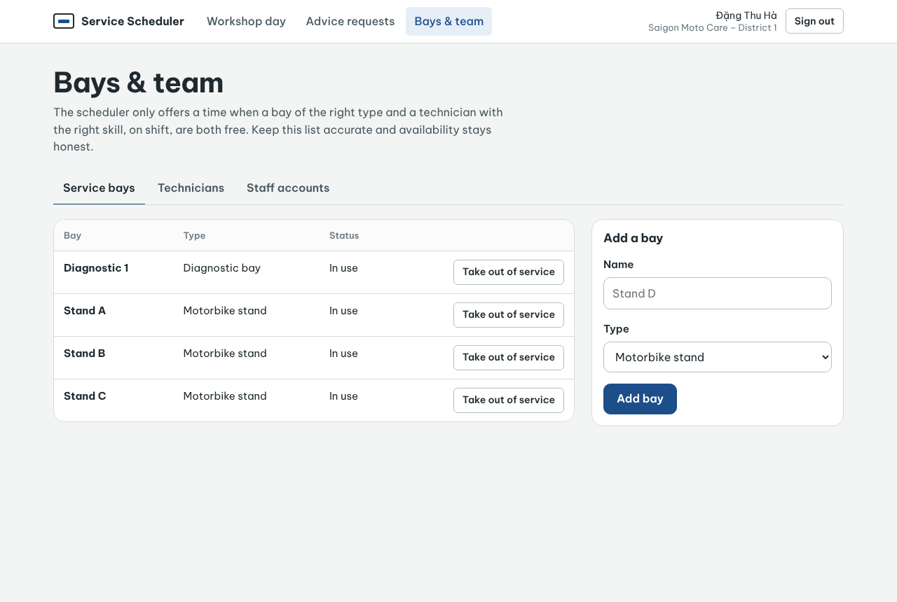


### TC-ADM-03 Add a technician with a login

| Step | Action | Expected result | Result |
| --- | --- | --- | --- |
| 1 | Tab **Technicians** | The four District 1 technicians with skills, shift and working days. Only Trần Quốc Hùng has a login | ☐ Pass ☐ Fail |
| 2 | Name `Ngô Văn Thử`; skills **General servicing** (pre-ticked) and **Brakes & suspension**; shift 08:00–17:30; Mon–Sat; Login email `tech.test@demo.vn`; Temporary password `Tech@2026`. Click **Add technician** | **Ngô Văn Thử** appears with `tech.test@demo.vn`, "Brakes & suspension, General servicing", 08:00–17:30 Mon–Sat | ☐ Pass ☐ Fail |
| 3 | Sign out, sign in as `tech.test@demo.vn` / `Tech@2026` | **My jobs** opens; the corner shows `Ngô Văn Thử · Saigon Moto Care – District 1` | ☐ Pass ☐ Fail |
| 4 | Sign out and sign in again as `admin.d1@demo.vn` | Back on the admin screens | ☐ Pass ☐ Fail |


### TC-ADM-04 Create a staff account

| Step | Action | Expected result | Result |
| --- | --- | --- | --- |
| 1 | **Bays & team** → tab **Staff accounts** | Name, role and email of everyone at District 1 | ☐ Pass ☐ Fail |
| 2 | Name `Phạm Thị Cố Vấn`, Email `advisor.test@demo.vn`, Temporary password `Advisor@2026`, Role **Service advisor**, click **Create account** | **Phạm Thị Cố Vấn · Service advisor · advisor.test@demo.vn** appears in the table | ☐ Pass ☐ Fail |
| 3 | Click **Sign out** | The sign-in page appears | ☐ Pass ☐ Fail |


## 10. System manager

Sign in as **`sysadmin@demo.vn`**.

### TC-SYS-01 View all dealerships

| Step | Action | Expected result | Result |
| --- | --- | --- | --- |
| 1 | Sign in as `sysadmin@demo.vn` | **Dealerships** lists both dealerships with code, address, hours and open days, and live figures: active bays, active technicians and upcoming appointments | ☐ Pass ☐ Fail |


### TC-SYS-02 Onboard a dealership with its first admin

| Step | Action | Expected result | Result |
| --- | --- | --- | --- |
| 1 | In **Add a dealership**: Code `HN-CG`, Time zone `Asia/Ho_Chi_Minh`, Name `Hanoi Moto Hub – Cau Giay`, Address `88 Xuân Thủy, Cầu Giấy, Hà Nội`, opens 08:00, closes 17:30, Mon–Sat. First admin: Name `Trịnh Văn Quản`, Email `admin.hn@demo.vn`, Temporary password `Admin@2026` | The form is filled | ☐ Pass ☐ Fail |
| 2 | Click **Create dealership** | **Hanoi Moto Hub – Cau Giay** (`HN-CG`) appears with 0 bays, 0 technicians, 0 upcoming | ☐ Pass ☐ Fail |
| 3 | Sign out, sign in as `admin.hn@demo.vn` / `Admin@2026` | **Workshop day** for Hanoi Moto Hub – Cau Giay, with no bays and **Nothing booked**. The new admin sees only their own dealership | ☐ Pass ☐ Fail |
| 4 | Click **Sign out** | The sign-in page appears | ☐ Pass ☐ Fail |


### TC-SYS-03 A new dealership is not bookable until it has bays and technicians

| Step | Action | Expected result | Result |
| --- | --- | --- | --- |
| 1 | Sign in as `customer@demo.vn`. **Book a service** → **Honda Air Blade 160** → **Essential maintenance** → **Choose a time** | **Hanoi Moto Hub – Cau Giay** is now in the dealership list | ☐ Pass ☐ Fail |
| 2 | Click **Hanoi Moto Hub – Cau Giay** | Notice: **Hanoi Moto Hub – Cau Giay cannot do this job: it has no suitable bay or no technician with the right skills. Please choose another dealership.** No times are offered | ☐ Pass ☐ Fail |


## 11. Operations

### TC-OPS-01 Health check

| Step | Action | Expected result | Result |
| --- | --- | --- | --- |
| 1 | Open <http://localhost:8080/health> | `{"status":"ok","db":"ok"}` | ☐ Pass ☐ Fail |


### TC-OPS-02 API documentation

| Step | Action | Expected result | Result |
| --- | --- | --- | --- |
| 1 | Open <http://localhost:8080/docs> | Swagger UI titled **Unified Service Scheduler API** lists every endpoint grouped by Auth, Catalogue, Customer, Booking, Consultations, Staff, Admin, System and Operations | ☐ Pass ☐ Fail |
| 2 | Expand **POST /api/auth/login**, click **Try it out**, send `{"email":"customer@demo.vn","password":"Demo@2026"}` | Response 200 with a `token`. Click **Authorize**, paste the token, and the padlocked endpoints can be called | ☐ Pass ☐ Fail |


### TC-OPS-03 Metrics

| Step | Action | Expected result | Result |
| --- | --- | --- | --- |
| 1 | Open <http://localhost:8080/metrics> | Prometheus text format. After the tests above it includes `bookings_created_total`, `booking_conflicts_total{reason="race"}` (from TC-CUS-04), `appointment_status_changes_total`, `consultation_requests_total`, `auth_login_failures_total` (from TC-AUTH-02), `http_request_duration_seconds` and `db_query_duration_seconds` | ☐ Pass ☐ Fail |


### TC-OPS-04 Logs and request ID

| Step | Action | Expected result | Result |
| --- | --- | --- | --- |
| 1 | Watch the terminal running `npm run dev` while you book (TC-CUS-03) | Readable log lines such as `booking.created {requestId=…, userId=…, role=CUSTOMER, dealershipId=…, reference=SV-…}`. With `LOG_FORMAT=json` (the default outside `npm run dev`) each line is one JSON object | ☐ Pass ☐ Fail |
| 2 | Watch the terminal during TC-AUTH-02 | `auth.login_failed` with the email masked; the password never appears | ☐ Pass ☐ Fail |
| 3 | Watch during TC-CUS-04 | `booking.slot_unavailable` (or `booking.race_lost_retrying` followed by it) for the losing request | ☐ Pass ☐ Fail |
| 4 | In the browser's developer tools (F12 → Network), select any `/api/` request | The request and the response both carry the same `X-Request-Id`. Searching the log for that ID finds every line of that request | ☐ Pass ☐ Fail |

## 12. API checks without the UI

These use `curl` in Git Bash, WSL, macOS or Linux. On Windows PowerShell, use `curl.exe` and put
the JSON body in a file (`-d "@body.json"`), or run the same calls from Swagger UI (TC-OPS-02).

### TC-API-01 Calls without a token are refused

```bash
curl -i http://localhost:8080/api/me/appointments
```

Expected: `HTTP/1.1 401 Unauthorized` and
`{"error":{"code":"UNAUTHENTICATED","message":"Authentication required","requestId":"…"}}`. ☐ Pass ☐ Fail

### TC-API-02 A customer token cannot call admin endpoints

```bash
TOKEN=$(curl -s -X POST http://localhost:8080/api/auth/login -H 'content-type: application/json' \
  -d '{"email":"customer@demo.vn","password":"Demo@2026"}' | sed 's/.*"token":"\([^"]*\)".*/\1/')
curl -i http://localhost:8080/api/admin/bays -H "authorization: Bearer $TOKEN"
```

Expected: `HTTP/1.1 403 Forbidden` with code `FORBIDDEN`. ☐ Pass ☐ Fail

### TC-API-03 The same Idempotency-Key never books twice

Send the same booking twice with one key (use a vehicle, package, dealership and a free `start`
from `GET /api/availability`; Swagger UI shows the exact body).

Expected: the first call answers `201 Created`; the second answers `200 OK` with the **same**
appointment and the header `Idempotent-Replayed: true`. ☐ Pass ☐ Fail

### TC-API-04 Automated suites

```bash
npm test           # 95 tests: unit, property-based, architecture, API, concurrency
npm run test:load  # three bursts of 1000 simultaneous HTTP requests
```

Expected: `All tests passed` for the 95 tests. The load test prints, for the same slot, exactly
as many `201` responses as free bay and technician pairs (4) and `409` for the rest, with no `5xx`;
1000 × `201` for spread bookings; 1000 × `200` for availability reads. ☐ Pass ☐ Fail

## 13. Rules that need real time to pass

| Rule | Why it is not in the manual run | How it is verified |
| --- | --- | --- |
| No-show only after the start time | D+1 is in the future | `ApiSpec` › "a no-show can only be recorded after the start time"; manually: book a time about 1 hour ahead on an open day, wait until it starts, then the board offers **Customer did not come** |
| A customer cannot cancel after the start | Same | `LifecycleSpec` › "lets a customer cancel only before the start time" |
| Bookings open at least 60 minutes ahead | Times inside the next hour show **Too soon** | Visible on today's grid during opening hours; `AvailabilitySpec` |
| Bookings at most 60 days ahead | Far days | `AvailabilityPropertySpec` (every slot shown as free is bookable) |
| Daylight-saving days | Vietnam has none | `AvailabilitySpec` › "keeps local wall-clock times across a daylight-saving change" (Europe/London) |

## 14. Results log

| Date | Tester | Cases run | Passed | Failed | Notes (request IDs of any errors) |
| --- | --- | --- | --- | --- | --- |
| | | | | | |
